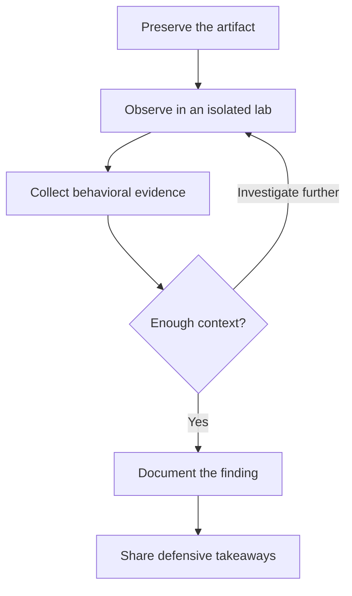

## Follow the anomaly

A suspicious file. A dependency that behaves unexpectedly. A connection that deserves another look. This notebook is a place to follow those threads and make the investigation easier to revisit.

The goal is to share the reasoning alongside the result: what was observed, how it was investigated, and what remains uncertain.

## What belongs here

This space brings together malware analysis, threat intelligence, detection engineering, and cryptographic research. The [research archive](/#research) also links to existing articles at their original publications.

- **Malware analysis:** file artifacts, behavior, and the relationships between them.
- **Threat intelligence:** connecting observations to a wider picture, with sources and uncertainty kept visible.
- **Tools:** projects that help researchers observe, analyze, and understand.
- **Field notes:** shorter observations and research workflows worth keeping.

## Reading the evidence

An indicator is a starting point. Its meaning depends on context, collection time, and the environment in which it was observed. Historical findings should be read in that context rather than treated as a live threat feed.

> Useful research makes it possible to distinguish observations, interpretations, and unanswered questions.

Future technical posts can include sample identifiers, lab conditions, an analysis timeline, and defensive takeaways where those details help a reader reproduce the reasoning.

## Visualizing the investigation

The image below illustrates three things to preserve during an investigation: the artifact itself, the behavior observed, and the context around the observation.

This is a conceptual workflow, not a report of a specific incident. The diagram below uses Mermaid to show how an observation becomes a documented finding, including the questions that send us back for another look.

Use **View diagram source** to inspect the Mermaid definition. The diagram follows the site's light and dark themes.

## Keep investigating

Explore [procSniper](https://github.com/KanakSasak/procSniper), [CupaX Sandbox](https://github.com/KanakSasak/cupax-sandbox), or the rest of my [public repositories](https://github.com/KanakSasak).

There is always another question behind the next observation.
