> Publication note: Original report text retained. Evidence-package file references are available as hover text; the underlying offline files are not hosted with this article.

**Threat research | 18 October 2026**

This report first completes the analysis of the malicious developer assessment: recruitment context, Git-hook triggers, Windows delivery, blockchain loader, application modules, C2, detection, and evidence limits. The final part extends the investigation into related blockchain infrastructure, with detailed analysis of publisher relationships, cross-chain pointers, Ethereum signaling, payload rotation, and reproducible hunting procedures.

The original delivery capture window was approximately 07:05–07:28 UTC on 14 October 2026. The proactive hunt uses retained blockchain collections through 17 October 2026. These are separate evidence scopes; the expanded resolver branch is not a demonstrated continuation of execution from the original archive on a victim host.

- [Part I — Complete Git-hook incident analysis](#part-i--complete-git-hook-incident-analysis)
- [Part II — Proactive hunting of the blockchain infrastructure](#part-ii--proactive-hunting-of-the-blockchain-infrastructure)

## Part I — Complete Git-hook incident analysis

### Context

The campaign begins with a familiar request for a developer: complete a short coding assessment before a hiring decision. In the supplied Upwork conversation, the sender shares a Google Drive link to a Golang skills-test ZIP and directs the candidate to its README. The analyzed archive contains a plausible programming exercise, but its required Git workflow can activate malicious hooks packaged with the repository.

Following the Windows delivery path revealed a chain that uses Node.js to retrieve a loader from blockchain transaction data, then downloads encrypted JavaScript and Python modules from HTTP servers. The recovered modules implement remote shell access, keyboard and clipboard monitoring, and browser and cryptocurrency-wallet collection.

Two blockchain networks serve distinct roles. TRON supplies a reference to the next payload; BNB Smart Chain (BSC) stores the encoded JavaScript loader in a transaction's input data. Downstream servers handle module delivery, interactive commands, and uploads. This separation is central to understanding the chain: the on-chain reference leads to executable code, which then leads to the operational infrastructure.

The findings combine captured server responses with static analysis of recovered code. They establish a malicious delivery chain and its intended capabilities, but do not establish compromise of the recipient's workstation. A control-flow issue in the captured Windows bootstrap may prevent that version from reaching the later stages.

#### Section IOCs and hunting markers

| Type | Indicator | Role and evidence status |
| --- | --- | --- |
| Archive SHA-256 | `8a681cb0ef19b1db0c42d4fc666c8a07eec1682ea3b2379066a50ce21b877491` | Identifies the analyzed assessment ZIP; screenshot alone does not verify the hosted bytes. |

### The recruitment lure

The supplied conversation screenshot shows a candidate agreeing to a short technical test in a discussion for a Golang engineering role. The sender then provides a Google Drive link, describes the assessment as a one-to-two-hour task, and allows 48 hours for submission. Instructions, requirements, and the submission process are said to be inside the ZIP's `README.md`. The visible hiring timeline is still awaiting a contract offer, placing the request in the recruitment process before a contract is shown as agreed.


*The delivery message directs the candidate from the recruitment conversation to an externally hosted ZIP and its README instructions.*

The README recovered from the <span title="Offline evidence reference: ./multichain-proactive-hunting/Multichain_Research_Update/baseline/evidence/original_archive.zip">analyzed archive</span> gives the assessment a concrete engineering context: repair a Go HTTP job-processing service, address worker-pool concurrency and backpressure, and improve shutdown behavior and tests. These requirements make routine repository activity a plausible part of completing the task.

The decisive instruction appears under **“Git workflow — required.”** The candidate is told to preserve the included `.git` directory, create a branch with `git switch -c candidate/<your-name>`, and make a `start test` commit before beginning the work. A second commit is requested on completion, and the submission must retain `.git` so the sender can review the history. This matters because the archive carries active `post-checkout`, `pre-commit`, and `pre-push` hooks inside that directory. Branch creation and commits can invoke the first two hooks; pushing can invoke the third, although the README does not require a push.

The archive therefore connects the social-engineering pretext directly to the execution mechanism: the candidate is encouraged to preserve the malicious hooks and perform operations that can trigger them. Delivering the repository as a ZIP preserves local Git metadata that a normal clone would not copy as active client-side hooks. Whether a hook actually executes still depends on the extracted permissions, Git configuration, available tools, and actions taken by the recipient.

The screenshot establishes the delivery message and recruitment pretext; it does not independently verify the bytes hosted at the Google Drive link, the sender's identity, or execution on a recipient's workstation. The hook and README findings come from the separately inspected archive.

#### Section IOCs and hunting markers

| Type | Indicator | Role and evidence status |
| --- | --- | --- |
| Archive SHA-256 | `8a681cb0ef19b1db0c42d4fc666c8a07eec1682ea3b2379066a50ce21b877491` | Exact analyzed artifact. |
| Hook SHA-256 | `9dd7e653c845bc8ca4f0ad781dbf1d82b2dbe5d8a9045ca8132d74c3b8911022` | Shared by the three malicious hooks in the archive. |
| Repository paths | `.git/hooks/post-checkout; .git/hooks/pre-commit; .git/hooks/pre-push` | Inspect contents and execution context; legitimate repositories can use these names. |

### How the delivery chain works

The recovered chain has six main steps:

1. **Present the assessment.** A recruitment message directs the candidate to a ZIP and its README.
2. **Trigger a repository hook.** The requested branch and commit operations can invoke executable hooks retained in `.git`.
3. **Prepare Node.js and retrieve the parser.** A short-link redirect leads to batch scripts that attempt to install a portable runtime and launch `parser.js`.
4. **Resolve the blockchain payload.** The parser reads a TRON transaction memo, derives a BSC transaction hash, and decodes the JavaScript stored in that transaction.
5. **Retrieve the application modules.** The decoded loader resolves an HTTP payload server, decrypts the bootstrap and client launcher, and prepares Node.js/Python execution.
6. **Establish control and collect data.** The application modules contain separate command channels and browser/wallet upload routines.


*The diagram summarizes relationships in the recovered artifacts. It is not a recorded execution trace from a victim host. [Retrieval evidence and artifact hashes](#retrieval-evidence-and-artifact-hashes) lists the individual retrieval results.*

#### Section IOCs and hunting markers

| Type | Indicator | Role and evidence status |
| --- | --- | --- |
| Entry URL | `chgver[.]s[.]gy/707w` | Captured redirect into the Windows delivery chain. |
| Payload service | `107.182.130[.]226:1244` | Captured encrypted bootstrap/client/module delivery. |
| TRON account | `TMpR4viF4xPeMAcgYDoF57ECAaDPpj1oXs` | Pointer feed used by the original parser; query context is needed to establish host activity. |
| BSC transaction | `0x4e1c5867249c1768eff6e2467d1983ae92cb60d28345b8424b080df32f9cd770` | Captured encoded loader publication; identifies code, not a victim. |

### From Git hooks to a Windows downloader

The three executable hooks in the original archive place the download trigger in repository operations a developer may perform while reviewing a project. The hook launches a download-and-execute pipeline during those operations.


For the Windows path, `chgver[.]s[.]gy/707w` returned an HTTP 302 redirect to `hxxp://167.148.88[.]203/707/707w`. The response matched the supplied batch downloader and performs three actions:

1. Deletes prior `%USERPROFILE%\parse` and `%USERPROFILE%\token.cmd` artifacts if present.
2. Downloads the next script from `hxxp://167.148.88[.]203/707/token.cmd`.
3. Invokes `%USERPROFILE%\token.cmd`.


The redirect leads to a plain-HTTP delivery server. All responses described here reflect the capture window on 14 October 2026.

#### Section IOCs and hunting markers

| Type | Indicator | Role and evidence status |
| --- | --- | --- |
| Entry URL | `chgver[.]s[.]gy/707w` | Captured HTTP redirect. |
| Redirect target | `hxxp://167.148.88[.]203/707/707w` | Captured Windows downloader. |
| Next-stage URL | `hxxp://167.148.88[.]203/707/token.cmd` | Referenced and recovered batch bootstrap. |
| Hook SHA-256 | `9dd7e653c845bc8ca4f0ad781dbf1d82b2dbe5d8a9045ca8132d74c3b8911022` | Exact content match across the three hooks. |

### Preparing the Node.js loader

The next script, `token.cmd`, attempts to relaunch itself through hidden PowerShell/cmd before preparing a Node.js environment. It queries `https://nodejs.org/dist/index.json`, downloads the corresponding x64 MSI, and uses `msiexec /a ... /qn` to extract it beneath the script directory. The intended portable interpreter is `nodejs\PFiles64\nodejs\node.exe`.

The script then downloads `parser.js` into `%USERPROFILE%\.task`, retrieves the package manifest, attempts `npm install axios` in that directory, and launches the parser. The use of nodejs.org provides a legitimate runtime source; the domain itself is not an attacker-controlled indicator.

The package manifest was served from `hxxp://167.148.88[.]203/399/package.json`. It names the package `tokendapp` and lists libraries such as axios, request, basic-ftp, clipboardy, and process-related packages. The manifest was inspected without installing its packages.


The package manifest resembles a smart-contract development project, with Hardhat scripts and a mixture of networking and system-related dependencies. The delivery trigger is the bundled Git hooks. Dependency names alone do not establish malicious behavior; the loader and module source provide that evidence. [Dependency analysis](#dependency-analysis) maps the declared packages to their supported roles.

The captured batch bootstrap also contains an ungrouped `& exit /b` in its restart logic. That command separator can cause the batch file to exit before it reaches the later preparation and launch commands. The downstream stages were recovered separately during analysis, so their availability does not demonstrate that this bootstrap successfully launched them on a workstation.

#### Section IOCs and hunting markers

| Type | Indicator | Role and evidence status |
| --- | --- | --- |
| Parser URL | `hxxp://167.148.88[.]203/707/parser.js` | Captured parser source. |
| Manifest URL | `hxxp://167.148.88[.]203/399/package.json` | Captured manifest; path differs from the parser directory. |
| Local paths | `%USERPROFILE%/token.cmd; %USERPROFILE%/.task/parser.js` | Code-defined paths; correlate writes and interpreter execution. |
| Parser SHA-256 | `c6b0092a4441d696733b03f677794b22c6079cef7efdbaa8c7c50ae7f0de8413` | Exact captured parser bytes. |

### The blockchain mechanism: a TRON pointer and a BSC payload

A blockchain transaction can carry arbitrary data as well as transfer value. Here, the malware reads that data through public APIs: it uses a TRON memo as a pointer and BSC transaction input as payload storage. No cryptocurrency payment by the recipient is required to read either record.

The obfuscated `parser.js` sets the runtime marker `sidx=30625599` and uses two blockchain networks to locate and recover the next JavaScript loader:

1. Reads the newest confirmed outgoing transaction for TRON address:
   `TMpR4viF4xPeMAcgYDoF57ECAaDPpj1oXs`.
2. Extracts `raw_data.data` from the transaction response.
3. Swaps the two halves of that hex string, then hex-decodes it into a BSC transaction identifier.
4. Uses the read-only JSON-RPC method `eth_getTransactionByHash`.
5. Hex-decodes the transaction input, reverses the resulting text, and XORs it with the repeating string `02020327030306210219`.
6. Replaces the first `9999` marker with `30625599` and attempts to start the decoded script using detached `node -e`.


Recovered transaction references:

| Network | Reference |
| --- | --- |
| TRON | `f1d8f489ea6ac58d954d3a9bbbf3c8032ae56547640ad371b2fe0eec949ae661` |
| BSC | `0x4e1c5867249c1768eff6e2467d1983ae92cb60d28345b8424b080df32f9cd770` |
| BSC sender | `0x1f9eeaf3ebf612983e729b57c270cfdd90ef44dc` |
| BSC destination | `0x000000000000000000000000000000000000dead` |

The parser accesses this data through `api.trongrid.io`, `bsc-dataseed.binance.org`, and the fallback `bsc-rpc.publicnode.com`. These services supply blockchain data; their presence in the code does not make them attacker-owned command-and-control (C2) infrastructure. The analysis used read-only requests and submitted no transactions.


The XOR key is embedded in the parser; the TRON memo supplies the BSC transaction reference, not the key. Reading the newest qualifying TRON transaction gives the operator a way to announce a different payload reference without changing the parser's configured wallet. This describes the selection mechanism in the captured code; the single recovered path in this report does not establish a history of payload rotations.

#### Section IOCs and hunting markers

| Type | Indicator | Role and evidence status |
| --- | --- | --- |
| TRON account | `TMpR4viF4xPeMAcgYDoF57ECAaDPpj1oXs` | Pointer feed used by the original parser; query context is needed to establish host activity. |
| BSC transaction | `0x4e1c5867249c1768eff6e2467d1983ae92cb60d28345b8424b080df32f9cd770` | Captured encoded loader publication; identifies code, not a victim. |
| BSC publisher | `0x1f9eeaf3ebf612983e729b57c270cfdd90ef44dc` | Sender of the original loader publication. |
| Decoded loader SHA-256 | `c43ee3e3535257a15617b89a5cd5f8ba7454076f94a1f8a46a1f1a4dc834b3e0` | Plaintext before runtime-marker replacement. |

### From the on-chain loader to encrypted HTTP payloads

The decoded loader contains two configuration-server addresses:

- Primary: `104.234.94[.]198:1144`.
- Fallback: `107.182.130[.]226:1144`.

The primary returned:

```text
JS6MTA3LjE4Mi4xMzAuMjI2LDEyNDQsMzYsNTk5
```

Removing `JS6` and Base64-decoding the remainder gives:

```text
107.182.130.226,1244,36,599
```

The loader then fetches `/main` from that address. It decrypts a colon-separated `salt:iv:ciphertext` response using PBKDF2-HMAC-SHA256 (100,000 iterations, 32-byte key) and AES-256-CBC with PKCS#7 padding. The password embedded in this loader is `Jg2oE^0&96R#`. It supplies `global.g=599` and `global.h=36` to the next script.

The blockchain lookup ends at this transition. Subsequent stages use ordinary server requests, with encrypted response bodies, to deliver the bootstrap, client launcher, and application modules.

#### Section IOCs and hunting markers

| Type | Indicator | Role and evidence status |
| --- | --- | --- |
| Primary configuration | `104.234.94[.]198:1144` | Captured response; request pattern /s/30625599/<host_identifier>. |
| Configuration fallback | `107.182.130[.]226:1144` | Coded fallback; not exercised by the successful primary lookup. |
| Bootstrap URL | `hxxp://107.182.130[.]226:1244/main` | Captured encrypted payload. |

### A second delivery branch

The parser also contains a separate HTTP delivery branch, scheduled after the blockchain attempt finishes and a further 60-second delay elapses. Not all preceding blockchain requests set explicit timeouts, so a stalled request could delay this branch as well.

Recovered HTTP endpoint:

`hxxp://144.172.118[.]214/api/service/d31f9d55700e71fd0aee56336e634d82`

The request includes `Authentication: jwt`. The script derives a 32-byte key with Node's `scryptSync`, using password `d31f9d55700e71fd0aee56336e634d82` and salt `salt`, then expects an AES-256-CBC response with Base64 IV/ciphertext. It intends to write decrypted JavaScript to `wct1ECFA.tmp` in the temp directory and invoke Node from there. It first attempts to install axios and socket.io-client in that temp directory.

The retrieval attempt returned HTTP 502 with `[Errno 111] Connection refused` in the response. No plaintext payload was recovered from this branch, leaving its behavior and family unresolved. The response records a failure at capture time, rather than evidence that the server is permanently unavailable.


#### Section IOCs and hunting markers

| Type | Indicator | Role and evidence status |
| --- | --- | --- |
| Delayed payload URL | `hxxp://144.172.118[.]214/api/service/d31f9d55700e71fd0aee56336e634d82` | Capture returned HTTP 502; no decrypted payload or operational C2 established. |
| Temporary filename | `wct1ECFA.tmp` | Intended decrypted-script output; host creation unobserved. |

### Launching the modules across platforms

The decrypted `/main` script retrieves `/client/36/599` and prepares a Python runtime from `107.182.130[.]226:2225/pd/<platform>`. The recovered Windows archive contains Python 3.11 under `.bash`. The loader also contains Linux and macOS runtime and persistence paths, although the initial delivery investigation focused on Windows.

The recovered loader defines the following paths and behaviors across platforms:

| Platform | Artifact / behavior |
| --- | --- |
| Windows | Python path under `%USERPROFILE%\.bash\python.exe`; detached, hidden Node/Python processes. |
| Linux | Python path beneath `~/.py/python/bin/cupsd`; autostart entry `~/.config/autostart/PyToolUpdater.desktop`. |
| macOS | A `PyToolUpdater` bootstrap block in `~/.zprofile`, with PID/log files under `/tmp`. |
| Unix paths | Node payload file `~/.viminf`. |
| All relevant platforms | Dependency installation beneath `~/.vscode`; telemetry POST code using `/t`. |

The client feeds Python modules to interpreter stdin (`-I -`) and JavaScript modules to Node stdin. This matters for investigation: a module can reach its interpreter without appearing as a named script on disk, making process and network telemetry useful alongside file-based evidence.

#### Section IOCs and hunting markers

| Type | Indicator | Role and evidence status |
| --- | --- | --- |
| Runtime service | `107.182.130[.]226:2225/pd/w; 107.182.130[.]226:2225/pd/wa` | Windows runtime selection; /pd/wa recovered. |
| Windows interpreter | `%USERPROFILE%/.bash/python.exe` | Source-defined runtime location. |
| Linux persistence | `~/.config/autostart/PyToolUpdater.desktop; ~/.viminf` | Source-defined artifacts; no installation demonstrated. |
| macOS persistence | `PyToolUpdater in ~/.zprofile` | Source-defined bootstrap marker; inspect contents and writer. |

### Remote access and collection capabilities

The six recovered application modules divide remote control, input monitoring, and data collection across JavaScript and Python components. All six download responses use the PBKDF2/AES scheme described above; the client selects modules according to platform conditions.

| Module | Language | Implemented capabilities / role |
| --- | --- | --- |
| `ncli` | JavaScript | Socket.IO remote access, interactive shell/terminal handling, file enumeration, file read/transfer, and remotely supplied script execution. Primary C2 `104.153.82[.]91:2800`; JSONKeeper backup configuration. |
| `payl` | Python | Socket.IO remote-shell client with command-output transfer, identity registration, heartbeats, and reconnect logic. C2 `107.182.130[.]29:2250`. |
| `payload` | Python | Custom TCP command client; arbitrary Python execution; Windows keyboard/mouse monitoring; clipboard buffering. TCP C2 `104.153.82[.]90:2245`; system-information reporting uses `107.182.130[.]213:1274`. |
| `brow` | Python | Chromium-family saved-password and saved-card data collection; Windows DPAPI/AES decryption attempts; uploads results to `107.182.130[.]213:1274/keys`. |
| `ldb` | JavaScript | Browser profile/database and wallet-extension collection, Solana identity-file collection, Exodus wallet collection, and macOS keychain-file collection; HTTP uploads to `107.182.130[.]213:1274/uploads` and `/keys`. |
| `mdb` | JavaScript | Alternate macOS module with browser/Chrome DevTools Protocol extraction, browser-launch/LaunchAgent handling, and file uploads to the same collection service. Selected by the client for sufficiently new Darwin versions. |

Together, these modules provide code paths for both interactive control and collection of browser and wallet data. The table describes capabilities present in source. Successful credential decryption, input capture, persistence, and exfiltration were not observed on a victim or validated by executing the modules.

#### Section IOCs and hunting markers

| Type | Indicator | Role and evidence status |
| --- | --- | --- |
| Node Socket.IO C2 | `104.153.82[.]91:2800` | Configured in ncli; no victim session established. |
| Python Socket.IO C2 | `107.182.130[.]29:2250` | Configured in payl; no victim session established. |
| Python TCP C2 | `104.153.82[.]90:2245` | Configured in payload; no victim session established. |
| Collection service | `107.182.130[.]213:1274/keys; 107.182.130[.]213:1274/uploads` | Source-defined collection destinations; no exfiltration performed during analysis. |

### C2 mechanism

The recovered chain separates server discovery, payload delivery, remote control, and data collection across several services. Blockchain transaction data leads the parser to a configuration loader; that loader resolves the payload server, while the downloaded modules contain their own command-and-control endpoints. This separation allows the delivery address and the operational C2 addresses to differ.

The sequence below describes the recovered code and configuration. Payload and configuration retrievals were captured during analysis, but no remote-control session or exfiltration was performed.

The configuration request uses `/s/30625599/<host_identifier>`, where the identifier combines hostname and username. The analysis used the synthetic value `analysis_vm`. After `/main` and `/client/36/599`, module requests follow paths such as `/ncli/36/599` and `/payload/36/599`. Payload-response encryption does not extend to the command channels: the configured clients use HTTP/WebSocket or raw TCP without TLS.

#### Remote command channels

Three modules implement separate remote-control clients:

| Module | Configured endpoint | Communication mechanism |
| --- | --- | --- |
| `ncli` | `104.153.82[.]91:2800` | Socket.IO with WebSocket and HTTP polling transports. Registers host information, accepts command and terminal events, and returns results. |
| `payl` | `107.182.130[.]29:2250` | Python Socket.IO client configured for WebSocket transport. Queues shell commands and returns output associated with a request identifier. |
| `payload` | `104.153.82[.]90:2245` | Custom TCP protocol carrying JSON messages preceded by a four-byte, big-endian length field. Dispatches numeric command codes. |

On connection, `ncli` emits an `info` event containing host and system information, the runtime/group values, a client version, and a persistent identifier stored in `~/.vscode/.argv8`. Incoming `cmd` events reach its command dispatcher, while `term` events open, write to, resize, or close an interactive terminal. Command responses use `cres`; terminal output and exit notifications use `tout` and `texit`. The client emits application heartbeats every 25 seconds and includes reconnect logic for connection failures, network changes, and wake events.

The `payl` client maintains its own persistent identifier in `~/.vscode/.argv3`. It registers through an `info` event and accepts `cmd` events containing a `req_id` and command text in `t`. Commands enter a queue, and results return through `cres` or, for larger output, `d_chnk` messages followed by `d_end`. Its application heartbeat interval is 15 seconds on macOS and 30 seconds elsewhere; acknowledgement checks and retry delays help it recover from interrupted connections.

The TCP `payload` client sends an initial identity message, then exchanges JSON objects with `code` and `args` fields. Its dispatcher includes shell execution under code `1`, retrieval and clearing of the buffered keyboard/clipboard data under code `3`, arbitrary Python execution under code `9`, and connection to an operator-supplied host/port under code `10`. Heartbeat code `98` carries ping/pong messages. The code contains reconnect and backoff handling, but no TLS wrapper around this socket.

#### Backup C2 discovery

The `ncli` module references `www.jsonkeeper[.]com/b/KRCKK` for backup C2 configuration. The recovered object includes `ns/nsp`, `ps/psp`, and `as/asp`. Its shuffled Base64 host fields all decode to `107.182.130[.]29`, with ports:

- `nsp=2800`.
- `psp=2245`.
- `asp=2250`.

After more than 20 connection errors against its primary endpoint, `ncli` attempts to retrieve this object, decode `ns`, and reconnect using `nsp`, producing the backup destination `107.182.130[.]29:2800`. JSONKeeper hosts the configuration; the decoded address is the remote-control destination. The other fields are configuration observations and do not establish that every module consults this URL.

#### Collection and status reporting

The collection modules send data to `107.182.130[.]213:1274`. The `/keys` path receives browser-extraction results and system-information reports. Requests include fields such as `ts`, `type`, `hid`, `ss`, and `cc`, which carry timestamps, identifiers, a result label, and content. The JavaScript collectors upload files to `/uploads` using multipart form data with fields including `uts`, `type`, `hid`, and `multi_file`.

Separate `/t` POSTs report loader status to `107.182.130[.]226:2225` from `/main` and to `107.182.130[.]226:1244` from the client launcher. Their text bodies include host/platform details and runtime or launch-status information. These status messages are distinct from the shell-command channels and the browser/wallet collection service.

The parser's delayed request to `144.172.118[.]214` remains an additional delivery branch. Its HTTP 502 response yielded no payload, so the available evidence does not establish what C2 mechanism, if any, that payload would use.

#### Section IOCs and hunting markers

| Type | Indicator | Role and evidence status |
| --- | --- | --- |
| Node Socket.IO C2 | `104.153.82[.]91:2800` | Configured in ncli; no victim session established. |
| Python Socket.IO C2 | `107.182.130[.]29:2250` | Configured in payl; no victim session established. |
| Python TCP C2 | `104.153.82[.]90:2245` | Configured in payload; no victim session established. |
| Collection service | `107.182.130[.]213:1274/keys; 107.182.130[.]213:1274/uploads` | Source-defined collection destinations; no exfiltration performed during analysis. |
| Backup configuration | `www.jsonkeeper[.]com/b/KRCKK` | Captured configuration object; do not classify all JSONKeeper traffic as malicious. |
| Node backup C2 | `107.182.130[.]29:2800` | Decoded fallback destination used by ncli logic. |

### Relationship to previously reported activity

[ThreatFox entry 1943050](https://threatfox.abuse.ch/ioc/1943050/) records the same TRON address and transaction, BSC transaction, and configuration-server pair in a separate fake developer-repository incident. The entry carries a ContagiousInterview tag and an Unknown Loader label. [Entry 1943162](https://threatfox.abuse.ch/ioc/1943162/) records the same Python Socket.IO endpoint and related delivery chain, with an OtterCookie label and an InvisibleFerret tag.

The exact transaction and infrastructure matches support a relationship between the delivery chains. They do not independently establish the family of every recovered module, the sender's identity, or attribution to a state actor. The sample examined here uses runtime marker `30625599` and group `599`; the public record describes different delivery and runtime markers.

#### Section IOCs and hunting markers

| Type | Indicator | Role and evidence status |
| --- | --- | --- |
| TRON account | `TMpR4viF4xPeMAcgYDoF57ECAaDPpj1oXs` | Pointer feed used by the original parser; query context is needed to establish host activity. |
| BSC transaction | `0x4e1c5867249c1768eff6e2467d1983ae92cb60d28345b8424b080df32f9cd770` | Captured encoded loader publication; identifies code, not a victim. |
| Configuration endpoint | `104.234.94[.]198:1144` | Exact overlap discussed in the cited public record; not identity attribution. |

### Detection and hunting

The strongest detection opportunity is the transition from a development task to unexpected interpreter and network activity. Correlate process ancestry, file creation, and outbound connections rather than treating Git, Node.js, Python, or a public blockchain service as malicious on its own.

| Point in the chain | What to hunt for | Supporting context |
| --- | --- | --- |
| Repository trigger | Git or an IDE spawning a shell with curl/wget and a download-and-execute pipeline. | Bundled `post-checkout`, `pre-commit`, or `pre-push`; `/707w`; creation of `token.cmd` or `.task/parser.js`. |
| Runtime preparation | Portable Node extraction or Python execution from unusual user-profile locations. | `msiexec /a`, `.bash/python.exe`, and stdin-fed execution such as `python -I -`. |
| Payload retrieval | An interpreter making configuration and module requests in sequence. | `/s/30625599/<identifier>` on port 1144, then `/main`, `/client/36/599`, or module paths on port 1244. |
| Remote control | Node/Python connections to the recovered C2 IP-and-port pairs. | Socket.IO on ports 2800/2250 or length-prefixed TCP on port 2245; correlate with the originating process. |
| Collection | Unexpected interpreter access to browser or wallet files followed by uploads. | `Local State`, `Login Data`, extension stores, or Solana `id.json`, then `/keys` or `/uploads` on port 1274. |
| Persistence | Interpreter-written autostart, shell-profile, or LaunchAgent artifacts. | `PyToolUpdater`, `~/.viminf`, or `com.local.cdp.chrome.plist`, supported by process and network evidence. |

During triage, establish the furthest supported stage: exposure to the repository, hook/downloader execution, module launch, C2 communication, or upload. A retrieved payload or successful connection alone does not prove credential theft. Check whether the captured bootstrap exited before launching the parser.

The proposed analytics require local validation and tuning against approved developer workflows. [Detailed detection recommendations](#detailed-detection-recommendations) provides the detailed matching logic, artifact paths, telemetry requirements, and validation guidance.

#### Section IOCs and hunting markers

| Type | Indicator | Role and evidence status |
| --- | --- | --- |
| Node Socket.IO C2 | `104.153.82[.]91:2800` | Configured in ncli; no victim session established. |
| Python Socket.IO C2 | `107.182.130[.]29:2250` | Configured in payl; no victim session established. |
| Python TCP C2 | `104.153.82[.]90:2245` | Configured in payload; no victim session established. |
| Collection service | `107.182.130[.]213:1274/keys; 107.182.130[.]213:1274/uploads` | Source-defined collection destinations; no exfiltration performed during analysis. |

### Indicators of compromise

| Indicator | Role / confidence |
| --- | --- |
| `chgver[.]s[.]gy/707w` | Confirmed entry redirect. |
| `167.148.88[.]203:80` | Confirmed batch/parser/package delivery server. |
| `104.234.94[.]198:1144` | Confirmed configuration response. |
| `107.182.130[.]226:1144` | Coded configuration fallback; primary was sufficient during capture. |
| `107.182.130[.]226:1244` | Confirmed encrypted main/client/module delivery. |
| `107.182.130[.]226:2225` | Confirmed Windows runtime delivery; coded telemetry endpoint. |
| `104.153.82[.]91:2800` | Node Socket.IO C2 from source. |
| `107.182.130[.]29:2800` | Decoded Node backup configuration. |
| `107.182.130[.]29:2250` | Python Socket.IO C2 from source. |
| `104.153.82[.]90:2245` | Python TCP C2 from source. |
| `107.182.130[.]29:2245` | Backup configuration field; not a verified live connection. |
| `107.182.130[.]213:1274` | Credential/system-information and file-collection destination from source. |
| `144.172.118[.]214:80` | Coded delayed AES payload source; retrieval failed. |
| `www.jsonkeeper[.]com/b/KRCKK` | Confirmed hosted backup configuration. |
| `147.124.202[.]194` | Comment-only previous host string in payl; inactive in the captured source. |

For detection, pair these indicators with the process sequence and specific request paths. Loopback `127.0.0.1`, Apple's plist DTD URL, nodejs.org, the blockchain API hosts, and ip-api.com are not attacker-ownership indicators solely because the malware references them.

#### Section IOCs and hunting markers

The table above is the consolidated IOC set for the original incident. Its role/confidence column distinguishes captured responses, source-defined endpoints, fallback fields, and inactive strings.

### Assessment

The defining feature of this sample is the connection between a credible programming assessment and a hidden execution path inside the repository's Git metadata. The README asks the candidate to perform the operations that can trigger the hooks, while the later chain separates payload discovery, module delivery, command execution, and data collection.

TRON and BSC provide an indirect route to the loader. The downloaded modules then use conventional remote-control and upload services, giving defenders opportunities to correlate repository activity with interpreter execution and network traffic. The recovered source supports a serious risk of remote access and credential or wallet exposure if the chain executes successfully. The available evidence does not establish that outcome on a recipient's workstation, and the bootstrap defect remains a material limit on this captured delivery path.

#### Section IOCs and hunting markers

| Type | Indicator | Role and evidence status |
| --- | --- | --- |
| TRON account | `TMpR4viF4xPeMAcgYDoF57ECAaDPpj1oXs` | Pointer feed used by the original parser; query context is needed to establish host activity. |
| BSC transaction | `0x4e1c5867249c1768eff6e2467d1983ae92cb60d28345b8424b080df32f9cd770` | Captured encoded loader publication; identifies code, not a victim. |

### Analysis scope and limitations

The original investigation recovered the short-link response, `token.cmd`, `parser.js`, the package manifest, the blockchain-stored loader, the configuration response, encrypted `/main` and `/client/36/599` responses, all six encrypted application modules, the Windows Python runtime archive, and a backup C2 configuration.

Retrieval, decryption, decompression, and deobfuscation treated the malware as data. No supplied batch, JavaScript, Python, npm lifecycle script, MSI, PE executable, or Git hook was executed. No remote-shell or Socket.IO bot session was established, and no host-information or exfiltration POST was sent to the malware services. The configuration lookup used the synthetic identifier `analysis_vm`.

Several questions remain open. The delayed HTTP/AES branch did not yield a payload, and future operator commands could deliver additional code beyond the recovered set. The investigation did not establish whether any stage executed on the original workstation or FLARE-VM. Alternate runtime archives and the initial macOS/Linux short-link responses were not collected, and the bundled runtime did not undergo a complete integrity audit.

#### Section IOCs and hunting markers

This section introduces no additional IOCs. The value `analysis_vm` is an analyst-supplied identifier and must not be treated as a victim identifier or malicious artifact.

### Retrieval evidence and artifact hashes

The following stages describe the recovered artifacts and source-defined relationships. Stage numbers are assigned for this report; they do not represent a recorded execution sequence on a victim host.

| Stage | Artifact / source | Verified result |
| --- | --- | --- |
| 1 | Three executable hooks in the original ZIP | Checkout/switch, commit, or push can launch a download-and-execute pipeline. |
| 2 | `chgver[.]s[.]gy/707w` | HTTP 302 to `hxxp://167.148.88[.]203/707/707w`; returned the supplied batch downloader. |
| 3 | `167.148.88[.]203/707/token.cmd` | Downloads Node.js if required; references parser and package-manifest downloads; attempts hidden restart and parser launch. |
| 4 | `167.148.88[.]203/707/parser.js` | Obfuscated JavaScript containing a blockchain branch and a delayed HTTP/AES branch. |
| 5 | TRON memo → BSC transaction input | Recovered an XOR-encoded JavaScript loader and statically decoded it. |
| 6 | `104.234.94[.]198:1144/s/30625599/analysis_vm` | Returned `JS6` + Base64 configuration pointing to `107.182.130[.]226:1244`, with `h=36` and `g=599`. |
| 7 | `107.182.130[.]226:1244/main` | Decrypted platform bootstrap: Python runtime preparation, module-loader launch, telemetry code, and macOS/Linux persistence logic. |
| 8 | `107.182.130[.]226:1244/client/36/599` | Decrypted module launcher for three JavaScript and three Python payloads, with platform-dependent selection. |
| 9–10 | `ncli`, `payl`, `payload`, `brow`, `ldb`, `mdb` | All six responses recovered and decrypted; Python packing removed; JavaScript string tables decoded. |
| 11 | `www.jsonkeeper[.]com/b/KRCKK` | Retrieved encoded backup C2 configuration; decoded the address `107.182.130[.]29`. |

#### Downloader syntax notes

The lines `::@echo off` and `::cls` are comments/label-style lines; they do not execute the echo/clear commands. The trailing bare `token.cmd` on the curl download line is an additional positional URL argument, not another output filename. It can cause an extra transfer attempt to a hostname named `token.cmd`; that argument is not needed for the confirmed IP-based payload download.

#### Windows runtime archive

After configuration resolution and decryption, the `/main` script prepares a platform runtime archive and fetches the client launcher:

`hxxp://107.182.130[.]226:1244/client/36/599`

Its runtime source is `hxxp://107.182.130[.]226:2225/pd/<platform>`. The Windows selection can use `/pd/w` or `/pd/wa`, based on its tar capability check. The `/pd/wa` response was recovered:

- 43,768,604 compressed bytes.
- gzip/tar archive with 7,094 entries beneath `.bash`.
- 130,219,881 total declared uncompressed bytes.
- Contains a Python 3.11 runtime, including `.bash/python.exe` and `.bash/python311.dll`.

#### Selected artifact hashes

The selected SHA-256 values below identify the recovered archive, hooks, loaders, and payloads. Plaintext source hashes are distinguished from hashes of encrypted HTTP bodies. The original analysis records the full inventory in `evidence-manifest.json` and the per-capture/decryption metadata.

| Artifact | SHA-256 |
| --- | --- |
| Original ZIP | `8a681cb0ef19b1db0c42d4fc666c8a07eec1682ea3b2379066a50ce21b877491` |
| Each malicious hook | `9dd7e653c845bc8ca4f0ad781dbf1d82b2dbe5d8a9045ca8132d74c3b8911022` |
| Captured Windows dropper | `0b453753847ddafb7761bb8a6a55d12a9a98ca8a157070081541d8862094339a` |
| Captured token.cmd | `89e44eac4d79a68017b164788da3e005cd2fc0bec094d4447ee030f5504e90ca` |
| Captured parser.js | `c6b0092a4441d696733b03f677794b22c6079cef7efdbaa8c7c50ae7f0de8413` |
| Blockchain decoded JS, before runtime-marker replacement | `c43ee3e3535257a15617b89a5cd5f8ba7454076f94a1f8a46a1f1a4dc834b3e0` |
| Decrypted main loader | `c443a6c9406abb13406be5618cc7831eaabf2f319beb66fe7de2a296a65f48f5` |
| Decrypted client loader | `c9ffa2bf788a4ad683d521333658d719d932b7ffa9f00667adc2daff6388d360` |
| Decrypted ncli JS | `2a1854d1517b15b4a05114f52f7028ea3bbd8789755d16be3b160162f9343024` |
| Fully unpacked payl Python | `88b31249e2d56489debd67dc7d3d597dc53744749503c9dfc1104ec4e57fd22e` |
| Fully unpacked payload Python | `e8b9966633ec2ec9911408e6afae722ca4168e9d5ff77dce3646ce8805b27784` |
| Fully unpacked brow Python | `7fd19af9724724dc9adc1612885123fc33de7609efac19f6874b2e1a3df22e49` |
| Decrypted ldb JS | `69a2c90d8813c66e3cb919c221f6616e9ce88e6e0c6c3ea332b011c97f6a6b34` |
| Decrypted mdb JS | `b6a6efb36c55a841e9e401033ddac0a91853fe3fd78a105020986bc5b540ae56` |
| Windows Python runtime archive | `647113e165122d3abc0c6935971524783354a357ed93e9b820226c0ab4da0eeb` |

Encrypted response hashes may differ between retrievals because the server can use fresh salts/IVs, even when decrypted code remains identical.

#### Section IOCs and hunting markers

The retrieval and SHA-256 tables above provide this section’s indicators. Match encrypted responses and plaintext artifacts separately; fresh encryption parameters can change response hashes without changing code.

### Dependency analysis

The recovered `package.json` names the project `tokendapp` and declares Hardhat as a development dependency. Its `test` and `deploy` scripts invoke Hardhat commands, giving the manifest the appearance of a smart-contract development project. The recovered delivery path, however, starts through Git hooks and a batch bootstrap; neither script is required to initiate that path.

The remaining dependencies include HTTP clients, an FTP client, clipboard access, and process-related packages. These declarations provide context for analysis, but package names alone do not establish how the payload behaves. The stronger evidence comes from tracing imports and function calls in the recovered source.

| Manifest entry | What the recovered evidence supports |
| --- | --- |
| `hardhat` | Declared under `devDependencies` and referenced by the test/deploy scripts. Its presence establishes the project's stated development context, rather than a demonstrated malware execution mechanism. |
| `axios`, `request` | HTTP-client dependencies. The parser's delayed branch explicitly uses axios to request an encrypted payload. Other recovered stages also use Node.js built-in HTTP/HTTPS modules, so network activity cannot be attributed to these packages solely from the manifest. |
| `clipboardy` | Declared, but its use for clipboard collection is not established in the reviewed source. The recovered Python `payload` module implements clipboard monitoring through `pyperclip`; no wallet-address replacement behavior was identified in that routine. |
| `basic-ftp` | Declared, but no FTP transfer path was identified in the reviewed application modules. Their documented file uploads use HTTP. |
| `child_process`, `crypto`, `fs`, `process` | The recovered JavaScript uses Node.js built-in modules for process creation, cryptography, file access, and runtime information. The similarly named npm entries do not establish that the separately published packages implement those operations. |
| `ps-node`, `execp`, `jsonwebtoken` | Declared dependencies whose role in the recovered delivery chain was not established. Their inclusion alone does not demonstrate security-tool discovery, command execution, or JWT processing. |

The bootstrap attempts `npm install axios` in the directory containing this manifest. Later loaders separately install `form-data`, `ws`, `socket.io-client`, and `node-pty` beneath `~/.vscode`. Those later dependencies have a clearer connection to the recovered functionality: the modules reference them for multipart uploads, WebSocket/Socket.IO communication, and interactive terminal handling.

The malicious assessment therefore rests on the loaders and application modules: their code retrieves and decrypts payloads, launches interpreters, exposes remote-control functions, and collects browser and wallet data. The manifest helps explain the environment the bootstrap attempts to prepare. Package installation and payload execution were not performed during this analysis.


#### Section IOCs and hunting markers

| Type | Indicator | Role and evidence status |
| --- | --- | --- |
| Manifest URL | `hxxp://167.148.88[.]203/399/package.json` | Campaign-specific delivery context; package names themselves are not standalone IOCs. |
| Manifest path | `%USERPROFILE%/.task/package.json` | Code-defined destination; correlate with parser and downloader artifacts. |

### Detailed detection recommendations

Detection should follow the relationship between repository activity, interpreter execution, and outbound communication. Individual components—Git hooks, Node.js, Python, blockchain APIs, and Socket.IO—have legitimate uses. Confidence increases when an unexpected process chain connects them to the recovered paths, destinations, or collection artifacts.

The recommendations below are derived from the captured code. They are proposed analytics for local validation and tuning; they have not been tested against production telemetry or a malware execution trace.

#### Prioritize correlated host behaviors

| Priority | Detection opportunity | Recommended matching logic and tuning |
| --- | --- | --- |
| High | Git hook launches a remote downloader | Identify Git or an IDE spawning a shell that invokes curl/wget, especially with a pipe to `cmd` or `sh`. Raise confidence when the command references `chgver[.]s[.]gy`, `/707w`, `/707m`, or `/707l`, or is followed by creation of `token.cmd` or `.task/parser.js`. Inspect the process ancestry because a shell may sit between Git and the downloader. Baseline approved repository hooks. |
| High | Unusual interpreter deployment and execution | Correlate `msiexec /a` extraction beneath a user profile, creation of the portable Node runtime, `.task/parser.js`, or `.bash/python.exe`, and subsequent execution from those locations. The combination of `.bash/python.exe` with `-I -` and an external connection is particularly relevant. Match the image path and arguments separately to accommodate quoting and path separators. |
| High | Interpreter establishes a recovered C2 connection | Join process and network records for Node/Python connections to the IP-and-port pairs in the indicator table. Prioritize connections from the recovered user-profile locations, particularly after Git activity. Broader searches for ports 2800, 2250, or 2245 should require additional process or destination context. |
| High | Browser or wallet access followed by an upload | Where file-read telemetry is available, identify unexpected Node/Python access to `Local State`, `Login Data`, `Local Extension Settings`, or `~/.config/solana/id.json`, followed by a connection to the collection service. Include attempted access to Exodus paths as a hunting lead; the captured collection code has implementation limitations, so an attempt does not establish successful theft. Exclude approved backup, migration, and security tooling based on verified identity and behavior. |
| High | macOS browser launched with debugging and weakened security flags | Look for Node launching Chrome/Brave with `--remote-debugging-port=9223`, `/tmp/chrome_stealth`, and flags such as `--disable-web-security` or `--no-sandbox`. Correlate with `.sd` output directories, the `com.local.cdp.chrome` LaunchAgent, or collection-service traffic. Browser automation can produce similar flags, so evaluate the parent, profile path, and destination together. |
| Medium | Persistence or client-state files appear | Monitor creation or modification of the paths listed below. Escalate when the writer is an unexpected interpreter or the same process tree makes a matching outbound connection. The existence of `.vscode`, `.bash`, or a shell profile alone is insufficient. |

#### Monitor the delivery and collection sequence

For network hunting, retain destination IP, port, HTTP method, host, URI, status, timestamps, and—where collection policy permits—selected request-field names. Use endpoint network telemetry to associate requests with the responsible process. DNS alone will miss the chain's direct-IP connections.

- **Configuration and module retrieval:** Look for `/s/30625599/<identifier>` on port 1144, followed by `/main`, `/client/36/599`, or `/<module>/36/599` on port 1244. Module names are `ncli`, `payl`, `payload`, `brow`, `ldb`, and `mdb`. Hunt for the broader path structure as well as the exact markers, which may change between samples. `analysis_vm` was an analyst-supplied value; detections should accommodate the hostname/username identifier used by the loader.
- **Runtime and status traffic:** Correlate `/pd/w` or `/pd/wa` downloads on port 2225 with interpreter creation on the host. `/t` POSTs to ports 2225 and 1244 provide an additional status-reporting signal. A file advertised as `pa.zip` may contain the recovered gzip/tar runtime, so content inspection is more useful than its advertised filename alone.
- **Remote-control sessions:** Inspect Socket.IO traffic associated with the recovered destinations on ports 2800 and 2250. A `/socket.io/` request or WebSocket upgrade alone is common to legitimate applications. Event names such as `info`, `cmd`, `term`, and `heartbeat` are useful supporting evidence only when application payloads are visible. The port-2245 channel uses a separate length-prefixed TCP protocol and will not appear as Socket.IO traffic.
- **Fallback discovery:** Correlate access to `www.jsonkeeper[.]com/b/KRCKK` with subsequent Node traffic to `107.182.130[.]29:2800`. Avoid classifying all JSONKeeper traffic as malicious.
- **Collection:** Prioritize interpreter-originated POSTs to `107.182.130[.]213:1274/keys` or `/uploads`. Supporting field names include `ts`, `type`, `hid`, `ss`, and `cc` for result reporting, and `uts`, `type`, `hid`, and `multi_file` for multipart uploads. Field names or generic URI paths alone are weak matches.

Blockchain API access becomes more useful when the same process subsequently contacts the configuration and payload services. Do not block nodejs.org or public blockchain providers solely because they appear in this chain. The observed heartbeat intervals can support session analysis, but should not be used as an exact timing signature.

#### Extend file and persistence coverage

Include the following artifacts in targeted hunts, preserving the creating process, user, timestamps, and contents where available:

| Platform / role | Artifacts |
| --- | --- |
| Windows delivery/runtime | `%USERPROFILE%/token.cmd`, `%USERPROFILE%/.task/parser.js`, `%USERPROFILE%/.task/package.json`, `%USERPROFILE%/.bash/python.exe`; temporary `gradle-9-bin_<number>` downloads. |
| Client identifiers and locks | `~/.vscode/.argv8`, `~/.vscode/.ncli.pid`, `~/.vscode/.argv3`, `~/.vscode/.argp3`, and `~/.vscode/.poc3`. These support client identity or instance management; they are not all persistence mechanisms. |
| Linux persistence/runtime | `~/.config/autostart/PyToolUpdater.desktop`, `~/.viminf`, and `~/.py/python/bin/cupsd`. |
| macOS persistence | A `PyToolUpdater` bootstrap block in `~/.zprofile`; `/tmp/PyToolUpdater.pid` and `/tmp/PyToolUpdater.log`. |
| macOS collection/browser launch | `~/Library/LaunchAgents/com.local.cdp.chrome.plist`, `~/Library/Logs/cdp-chrome.out.log`, `~/Library/Logs/cdp-chrome.err.log`, `/tmp/chrome_stealth`, `~/.sd/chrome`, and `~/.sd/brave`. The collector contains LaunchAgent cleanup logic, so include historical creation/deletion events. |
| Browser database staging | `%USERPROFILE%/AppData/Local/Temp/LoginData.db` and `webdata.db`, or their `/tmp` equivalents. These are staging paths referenced in code; creation and successful collection must be established from telemetry. |

Inspect `post-checkout`, `pre-commit`, and `pre-push` under the extracted repository's `.git/hooks`, and account for alternate hook locations configured through `core.hooksPath`. Preserve hook contents and archive metadata as evidence. Git documents hook placement and execution conditions in its [githooks reference](https://git-scm.com/docs/githooks).

#### Telemetry requirements and validation

On Windows, useful Sysmon sources include Event ID 1 for process creation, 3 for network connections, 11 for file creation, and 22 for DNS queries. Correlate using `ProcessGuid` and parent relationships where available. Network connection logging is disabled by default and requires configuration. These event types do not provide a general record of browser database reads or interpreter stdin; those observations require suitable EDR/file-access or laboratory instrumentation. See [Microsoft's Sysmon documentation](https://learn.microsoft.com/en-us/sysinternals/downloads/sysmon).

On macOS and Linux, collect process execution, outbound connections, and file changes through the available endpoint sensor or audit tooling. Confirm coverage for shell profiles, autostart entries, LaunchAgents, and temporary files. Validate whether full command lines are retained: stdin-fed modules may leave only `node -` or `python -I -` visible at process creation.

As an initial correlation window, test 15 minutes between delivery, interpreter execution, and outbound communication, then tune against local data. This is an analyst-selected starting point, not a measured execution duration. Retain independent alerts for later C2 activity and uploads, since a long-running client can outlive the initial window.

During triage, establish the furthest supported stage: repository exposure, downloader execution, module launch, C2 connection, or data upload. An HTTP 200 or WebSocket connection establishes communication, but does not by itself prove successful command execution or credential theft. Check whether the captured batch script reached the code after its restart line before linking later processes to that invocation.

Validate analytics in an isolated VM using synthetic browser/wallet data and controlled service responses. Review authorized development workflows for false positives, and preserve raw evidence before making analysis-only changes. If telemetry confirms an active unauthorized remote-control process, isolate the endpoint and scope accessed credentials and wallet material according to the incident-response procedure.

#### Section IOCs and hunting markers

| Type | Indicator | Role and evidence status |
| --- | --- | --- |
| Node Socket.IO C2 | `104.153.82[.]91:2800` | Configured in ncli; no victim session established. |
| Python Socket.IO C2 | `107.182.130[.]29:2250` | Configured in payl; no victim session established. |
| Python TCP C2 | `104.153.82[.]90:2245` | Configured in payload; no victim session established. |
| Collection service | `107.182.130[.]213:1274/keys; 107.182.130[.]213:1274/uploads` | Source-defined collection destinations; no exfiltration performed during analysis. |
| Windows staging | `%USERPROFILE%/.task/parser.js; %USERPROFILE%/.bash/python.exe` | Correlate process, network and file events; paths alone are insufficient. |


## Part II — Proactive hunting of the blockchain infrastructure

With the original delivery chain and its limits established, the investigation now shifts to infrastructure hunting. The starting points are the TRON pointer and BSC publisher recovered from the Git-hook parser. The goal is to trace related publications and resolver code, reconstruct how components are selected and rotated, and develop hunts that remain useful when individual payloads or server addresses change.

The findings below concern a broader, technically related corpus. Funding relationships and matching code justify expanding the investigation, but do not establish a common owner for every wallet or prove that the expanded chain ran on the original recipient's workstation. All times in this part are UTC.

### Hunting overview

The Git-hook investigation uncovered a malware delivery system that uses blockchain transactions to store code and tell a loader where to retrieve it. Its original branch follows a TRON memo to a BNB Smart Chain (BSC) transaction containing an encoded loader. Related historical infrastructure reveals a second mechanism: an Ethereum transaction signals which BSC publications contain the dispatcher, remote-access Trojan (RAT), and stage loader.

The operator can change one selected component by publishing new code and announcing its location in a new signal. The old transaction is not modified. In the captured Ethereum history, **six RAT versions were selected while the dispatcher and stage-loader locations remained unchanged**. That gives defenders a record of component rotation that can be reconstructed independently of a victim machine.

Three findings matter for hunting:

- **The recipient address carries the selection.** The 100 captured Ethereum signals have empty input and transfer 500 wei. Their recipient bytes encode BSC block numbers and transaction indexes.
- **Publication and discovery happen at different times.** The October 16 RAT was published at 16:09:25, announced at 16:12:47, and first appeared in a captured signal at a block position sampled by the resolver at 17:03:35.
- **The public history is broader than the loader's search.** Seventeen signals fall outside the block positions sampled by the recovered resolver. Monitoring full sender history preserves updates that a copy of that search would miss.

#### Section IOCs and hunting markers

| Type | Indicator | Role and evidence status |
| --- | --- | --- |
| Ethereum sender | `0x596dcc9fda875309ff85eba09cf5a97d8c7691bb` | Verified sender in the bounded 100-signal collection; monitor outgoing transactions. |
| Ethereum recipient | `0x0784a79e5207a13ec538079509c84b0783e08100` | Captured component-selection value; treat as encoded locations, not proof of recipient ownership. |

### Hunting scope and starting point

This proactive hunt begins with the Git-hook incident analyzed in Part I, where repository hooks were designed to retrieve a loader during ordinary development activity. Following references in the recovered code led to blockchain publications, earlier publishers, and a larger set of related resolver programs.

Blockchain payload storage and recipient-address encoding are established techniques. Ransom-ISAC's [XCTDH research](https://ransom-isac.org/blog/xctdh-adopts-hash-hiding/) describes TRON/Aptos indexing and an Ethereum channel that encodes a C2 IP address and port. The records examined here give recipient bytes a different meaning: **locations of malware components on BSC**. The interpretation is supported by consuming code and exact transaction matches. The finding should be presented as a documented component-selection mechanism, without claiming a global first discovery.

The link to the broader infrastructure rests on explicit pointers, shared recovered code and publisher relationships. It does not establish one owner for every related wallet. The original Git-hook branch and the expanded Ethereum resolver branch are also distinct: the available evidence does not demonstrate the expanded path executing end to end from the original archive.

#### Section IOCs and hunting markers

| Type | Indicator | Role and evidence status |
| --- | --- | --- |
| TRON account | `TMpR4viF4xPeMAcgYDoF57ECAaDPpj1oXs` | Pointer feed used by the original parser; query context is needed to establish host activity. |
| BSC transaction | `0x4e1c5867249c1768eff6e2467d1983ae92cb60d28345b8424b080df32f9cd770` | Captured encoded loader publication; identifies code, not a victim. |

### How the blockchain delivery works

The loader treats public transaction fields as a directory and a code store. A known account identifies a feed to inspect. A memo or argument identifies another transaction. That transaction contains encoded source code.

The original Git-hook branch follows five steps:

1. Query a known TRON account for a qualifying outgoing transaction.
2. Read its memo from `raw_data.data` and recover a BSC transaction hash.
3. Request that transaction through a BSC RPC provider.
4. Read the encoded JavaScript from the transaction's `input` field.
5. Decode the code using the loader's transformation and XOR key, then follow the recovered configuration and payload logic.

**The verified TRON memos contain transaction pointers, not XOR keys.** Keys are recovered from loader/resolver code or established through static decoding. Different components use different keys, and some keys are reused. The pointer identifies the record; the key decodes its contents. Neither is a wallet private key.

| Field | Role in the captured infrastructure |
| --- | --- |
| TRON memo | Encoded BSC transaction reference. The original branch swaps halves of the hex memo; other branches reverse decoded text. |
| Aptos transaction argument | A BSC reference in `payload.arguments[0]`; captured TRON and Aptos records point to the same resolver. |
| BSC transaction input | Encoded code: loaders, resolvers, RAT components and other programs. |
| Ethereum transaction recipient | A selection record identifying several BSC component locations. |

The endpoint makes the cross-chain queries. It reads a reference on one network and uses that value to request a record on another. This does not require a token bridge or cause one blockchain to execute code on another. The malware is designed to execute on the endpoint after retrieval.

**Figure 1. Two related retrieval paths and the expanded release-signaling mechanism.**

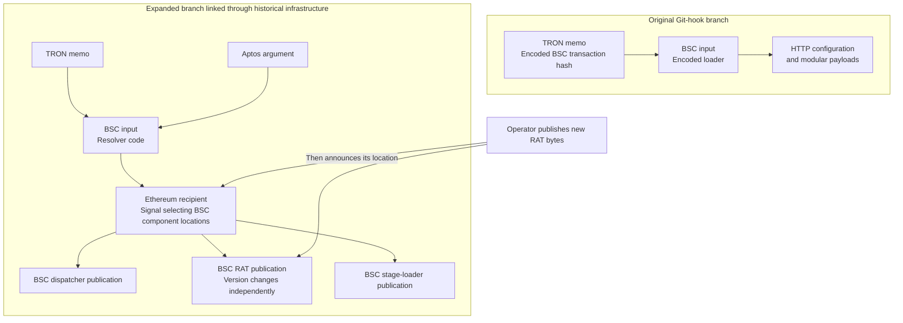

#### Section IOCs and hunting markers

| Type | Indicator | Role and evidence status |
| --- | --- | --- |
| TRON account | `TMpR4viF4xPeMAcgYDoF57ECAaDPpj1oXs` | Pointer feed used by the original parser; query context is needed to establish host activity. |
| BSC transaction | `0x4e1c5867249c1768eff6e2467d1983ae92cb60d28345b8424b080df32f9cd770` | Captured encoded loader publication; identifies code, not a victim. |
| TRON resolver feed | `TCqf6ZkaQD84vYsC2cuu1jRwB6JveTaRrF` | Expanded branch pointer feed. |
| Aptos account | `0x9d202c824402ca89e9aaccd2390b6f8b332ae743caa1469c695feb2781d56519` | Captured arguments point to BSC resolver publications. |

### The signaling mechanism

The expanded branch adds a selection layer between the resolver and the payloads. TRON and Aptos records identify a BSC resolver. That resolver searches Ethereum transactions for a particular sender pattern and reads the recipient of the first matching transaction in its search order.

The recipient is a 20-byte value. The recovered code treats its first three five-byte groups as BSC locations: four bytes for a block number and one byte for a transaction index. A fourth group exists, but its consumer has not been established.

The captured October 17 signal contains:

```text
0x 0784a79e52 07a13ec538 079509c84b 0783e08100
   dispatcher RAT        loader     unassigned
```

| Component | Encoded group | Decoded BSC location |
| --- | --- | --- |
| Dispatcher | `0784a79e52` | Block 126134174, transaction index 82 |
| RAT | `07a13ec538` | Block 128007877, transaction index 56 |
| Stage loader | `079509c84b` | Block 127207880, transaction index 75 |

These positions match three captured BSC publications. Their input data decodes with the keys used by the respective consumers. The endpoint retains the entire recipient as `global.ix`, so the dispatcher can pass the same selection context to the RAT and loader resolvers.

**Figure 2. Recipient layout and the three source-established consumers.**

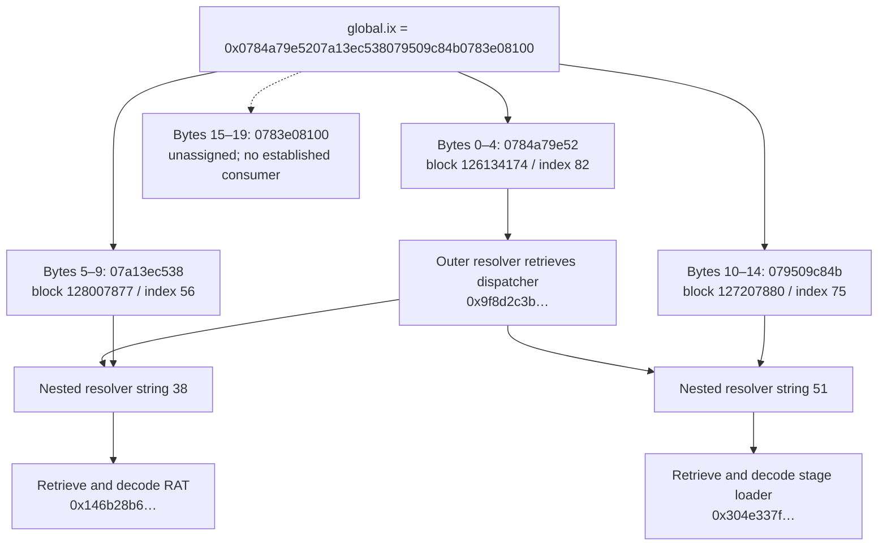

The Ethereum transaction is therefore a **release announcement**. It identifies which published components to retrieve. It does not demonstrate an interactive command or an immediate update to every running implant.

#### Section IOCs and hunting markers

| Type | Indicator | Role and evidence status |
| --- | --- | --- |
| Ethereum sender | `0x596dcc9fda875309ff85eba09cf5a97d8c7691bb` | Verified sender in the bounded 100-signal collection; monitor outgoing transactions. |
| Ethereum recipient | `0x0784a79e5207a13ec538079509c84b0783e08100` | Captured component-selection value; treat as encoded locations, not proof of recipient ownership. |
| Selected RAT transaction | `0x146b28b62a385ca37775d6217c6299838a5ba90b448e203e0ab7c2c3e48134b9` | BSC block 128007877, index 56; publication selected by recipient bytes. |

### Following the signal across chains

One captured path provides a concrete example:

| Evidence | Reference or result |
| --- | --- |
| TRON memo transaction `aac5df30…` | Reversed memo text identifies BSC resolver `0x964107fc…`. |
| Aptos transaction `0x2e576cd4…` | Argument 0 identifies that same BSC resolver. |
| BSC resolver `0x964107fc…` | Searches Ethereum senders for `596dcc9fda875309ff85eba09cf5a97d`. |
| Ethereum signal `0x48d71961…` | From `0x596dcc9fda875309ff85eba09cf5a97d8c7691bb`; its recipient selects the three BSC positions above. |
| Selected BSC publications | Dispatcher `0x9f8d2c3b…`, RAT `0x146b28b6…`, loader `0x304e337f…`. |

Abbreviations keep the path readable; full identifiers, raw-source links and hashes appear in [Exact transformations and transaction proofs](#exact-transformations-and-transaction-proofs) and the evidence references.

The resolver does not simply ask for the sender's latest transaction. It reads the Ethereum head, aligns to a 256-block boundary, adds five, and inspects three adjacent blocks at each of a series of backward offsets. It stops when a sender contains the embedded marker.

For the saved head **26211484**, the resolver checks **26211333**, **26211334**, then **26211335**. The matching signal occurs in the third block. It then retrieves BSC blocks and selects the transaction at each encoded index. The outer resolver retrieves the dispatcher; two nested resolver strings retrieve the RAT and stage loader.

**Figure 3. Sparse block search and the captured stopping point.**

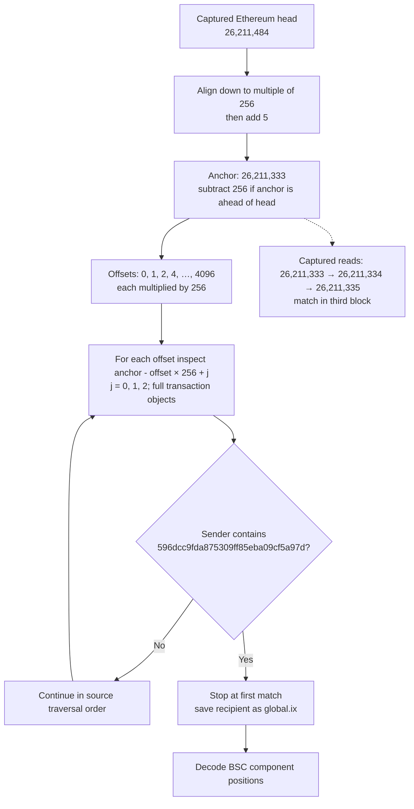

The exact field interpretation matters. Decoding these recipient bytes as an IP address would miss the component references established by the source. Likewise, a detector limited to smart-contract calls would miss the observed reads of historical transaction input.

#### Section IOCs and hunting markers

| Type | Indicator | Role and evidence status |
| --- | --- | --- |
| BSC resolver transaction | `0x964107fcc771daf0081fb492b286d1f53d95e751190f32999becf4a7266a2908` | Captured source interprets Ethereum recipient bytes as BSC locations. |
| Ethereum sender | `0x596dcc9fda875309ff85eba09cf5a97d8c7691bb` | Verified sender in the bounded 100-signal collection; monitor outgoing transactions. |
| Ethereum recipient | `0x0784a79e5207a13ec538079509c84b0783e08100` | Captured component-selection value; treat as encoded locations, not proof of recipient ownership. |

### How the operator rotates a payload

Rotation requires a new publication and a new selection signal. It does not replace the contents of an existing transaction.

The operator publishes an encoded RAT in a new BSC transaction, then sends an Ethereum signal whose recipient identifies that publication's block and index. The dispatcher and stage-loader locations can remain unchanged. A later resolver invocation can discover the new selection, subject to its search order and runtime conditions.

**Figure 4. Publication and selection are separate operations.**

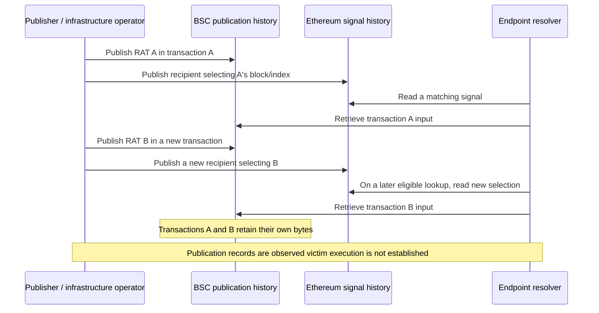

The October 15–16 transition shows exactly that change:

```text
October 15: 0x 0784a79e52 079ef78a29 079509c84b 0783e08100
October 16: 0x 0784a79e52 07a13ec538 079509c84b 0783e08100
                         ^^^^^^^^^^
                         only the RAT location changes
```

| Selected RAT | BSC location | Decoded code |
| --- | --- | --- |
| October 15: `0xd5de281a…` | 127858570 / 41 | 84,385 bytes; SHA-256 begins `1e5b7eb0…` |
| October 16: `0x146b28b6…` | 128007877 / 56 | 78,966 bytes; SHA-256 begins `309cc258…` |

The different decoded hashes establish different published code. The unchanged other groups establish that this transition retains the same dispatcher and stage-loader references. Full hashes are provided in the technical case study in [Exact transformations and transaction proofs](#exact-transformations-and-transaction-proofs).

**Figure 5. Only the RAT locator changes in this transition.**

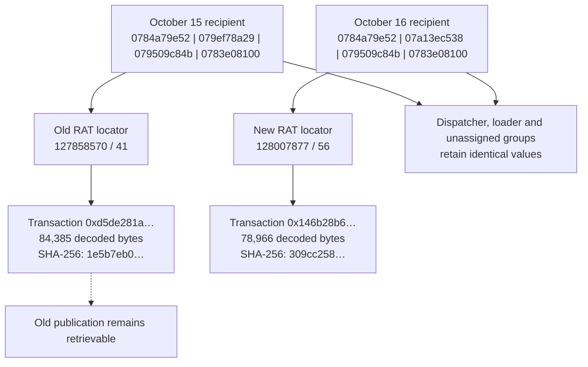

#### Section IOCs and hunting markers

| Type | Indicator | Role and evidence status |
| --- | --- | --- |
| Ethereum sender | `0x596dcc9fda875309ff85eba09cf5a97d8c7691bb` | Verified sender in the bounded 100-signal collection; monitor outgoing transactions. |
| Ethereum recipient | `0x0784a79e5207a13ec538079509c84b0783e08100` | Captured component-selection value; treat as encoded locations, not proof of recipient ownership. |
| Replacement RAT transaction | `0x146b28b62a385ca37775d6217c6299838a5ba90b448e203e0ab7c2c3e48134b9` | October 16 publication; compare decoded code and the changed recipient group. |
| Changed selector group | `079ef78a29 → 07a13ec538` | RAT block/index change; a scoped selection marker, not an IP address. |

### Signal cadence and rotation timeline

The retained sender history contains **100 transactions**, spanning October 13 at 20:33:59 through October 17 at 09:19:35. Their nonces run consecutively from 201 to 300. This is a bounded collection, not the sender's lifetime history.

All 100 signals have empty input and a value of 500 wei. The median interval between signals is **51m24s**, and the median block spacing is 256. The series contains six recipient values and five transitions; only the RAT group changes. These measurements describe publication activity, not infections.

| RAT publication UTC | First captured announcement UTC | Delay | Signals in window |
| --- | --- | --- | ---: |
| October 13 15:50:01 | October 13 20:33:59 | 4h43m58s; collection begins after publication | 20 |
| October 14 13:25:32 | October 14 13:42:35 | 17m03s | 5 |
| October 14 17:56:15 | October 14 18:00:11 | 3m56s | 26 |
| October 15 15:26:25 | October 15 16:14:59 | 48m34s | 7 |
| October 15 21:28:43 | October 15 22:14:23 | 45m40s | 21 |
| October 16 16:09:25 | October 16 16:12:47 | 3m22s | 21 |

The five transitions with a preceding selection visible have a median publication-to-announcement delay of **17m03s**. That gives publisher monitoring a potential lead over signal monitoring. It is not a measured period before victim compromise.

Announcement also differs from discoverability. The first October 16 announcement is outside the block positions sampled by this resolver. The first captured announcement for that RAT in a sampled position occurs at **17:03:35**, or **54m10s after publication**. Even then, actual selection depends on the resolver's invocation head and traversal path.

**Figure 6. October 16: publication, announcement and sampling eligibility.**

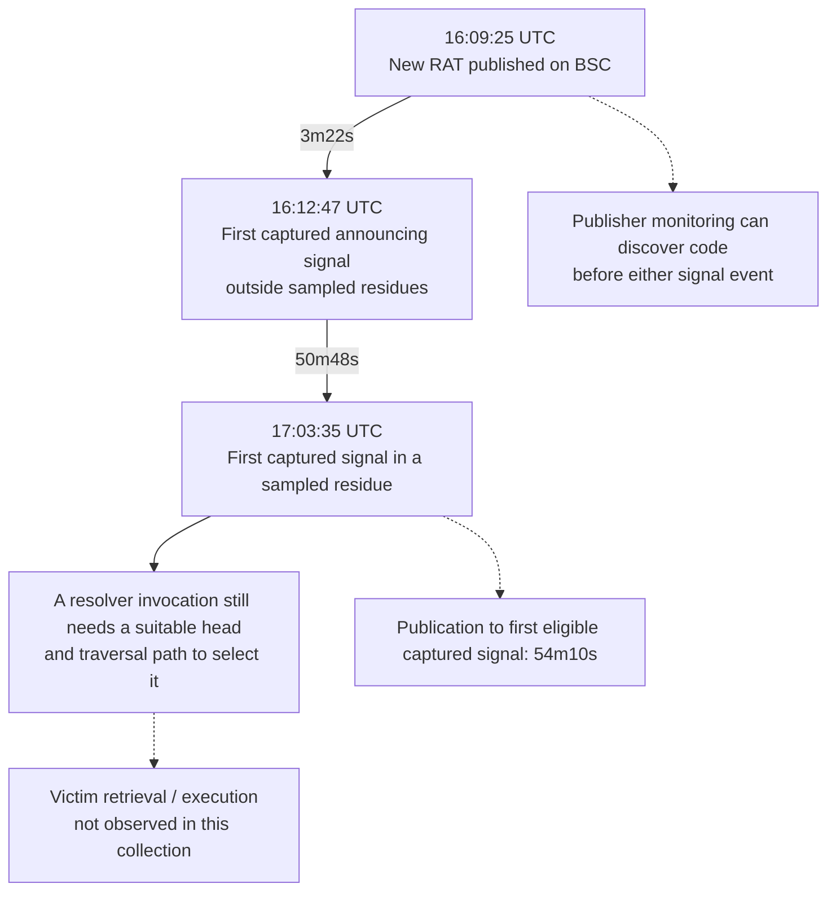

Across the full window, **83 signals occur in the sampled block residues and 17 do not**. A defender should collect the sender's complete history, then separately replay the malware's search to understand what a given consumer could select. The 17 excluded signals are not a measured malware failure rate.

#### Section IOCs and hunting markers

| Type | Indicator | Role and evidence status |
| --- | --- | --- |
| Ethereum sender | `0x596dcc9fda875309ff85eba09cf5a97d8c7691bb` | Verified sender in the bounded 100-signal collection; monitor outgoing transactions. |
| Ethereum recipient | `0x0784a79e5207a13ec538079509c84b0783e08100` | Captured component-selection value; treat as encoded locations, not proof of recipient ownership. |

### What the selected code can do

The October 16 RAT contains remote-command handling, host/session reporting, clipboard collection and process-execution capabilities. Its source sets `http://154.91.0.20:443` as the control base and `http://166.0.106.182` as the upload base. The first URL uses HTTP despite port 443. No current service response or successful victim session is established by these source references.

The October 15 RAT also contains a child program that can append an injection body to installed developer applications and npm. Targets include VS Code, Cursor, Antigravity, Discord and GitHub Desktop. This path is conditional: the parent reaches it through error handling, and the child requires a suitable runtime body and passes version/environment gates. Its presence establishes a capability, not a successful installation.

The recovered RAT reports the selection value as `IX`. When present in acquired memory or captured metadata with the right context, that value can tie host evidence to the dispatcher/RAT/loader tuple. This makes version tracking useful beyond maintaining an IP list.

#### Section IOCs and hunting markers

| Type | Indicator | Role and evidence status |
| --- | --- | --- |
| RAT control base | `hxxp://154.91.0[.]20:443` | October 16 source reference; HTTP despite port 443, not a verified live session. |
| Upload base | `hxxp://166.0.106[.]182` | Selected RAT/stage-loader source reference; current availability unestablished. |
| Injection child SHA-256 | `38d17bc43e95e02b0db90fd51470df5430bbbf90c858a317c2480db673b34045` | Extracted October 15 child bytes; conditional application-modification capability. |

### Detection and hunting

The most useful detections combine a specific infrastructure reference with the process or artifact that used it. Blockchain gateway traffic alone is common in developer environments.

| Hunt | Evidence to collect | Interpretation |
| --- | --- | --- |
| New BSC publication | Watched publisher, transaction input, decoded hash and changed call sites | Identifies code before a later signal selects it. Unknown encodings remain analysis leads. |
| Changed Ethereum recipient | Exact sender, recipient groups, matching BSC positions and decoder output | Identifies a component-selection change. Do not require zero-value transfers. |
| Resolver followed by payload/C2 traffic | Node/Python ancestry, exact chain query where visible, subsequent source-derived destination | Connects infrastructure retrieval to a host. TLS/DNS-only visibility limits field-level correlation. |
| Modified developer application | Unexpected marker tail, integrity mismatch and writer process | Investigates the conditional injection path; compare with the same trusted application version. |
| `IX` in endpoint state | Full recipient value and surrounding RAT metadata or source context | Associates a host artifact with a release; the short string `IX` alone is not distinctive. |

A useful starting point is retrospective hunting for the modern configuration services and the selected RAT's control/upload pair, followed by application integrity checks on matching hosts. Independently, collect outgoing history for the known publishers and signal sender. Repeated identical signals should update last-seen time; validated component changes should prompt code comparison and watchlist review.

Detailed analytics, false-positive considerations, application paths and collection procedures are retained in <span title="Section not included in the updated source report: #detailed-hunting-and-collection-procedures">Detailed hunting and collection procedures</span>. The analysis and reproduction tools work on saved records without executing the recovered malware.

#### Section IOCs and hunting markers

| Type | Indicator | Role and evidence status |
| --- | --- | --- |
| Ethereum sender | `0x596dcc9fda875309ff85eba09cf5a97d8c7691bb` | Verified sender in the bounded 100-signal collection; monitor outgoing transactions. |
| Ethereum recipient | `0x0784a79e5207a13ec538079509c84b0783e08100` | Captured component-selection value; treat as encoded locations, not proof of recipient ownership. |
| RAT control base | `hxxp://154.91.0[.]20:443` | October 16 source reference; HTTP despite port 443, not a verified live session. |
| Upload base | `hxxp://166.0.106[.]182` | Selected RAT/stage-loader source reference; current availability unestablished. |

### Indicators and infrastructure roles

#### Blockchain watchlist

| Chain and entity | Role and evidence | Recommended action |
| --- | --- | --- |
| TRON `TMpR4viF4xPeMAcgYDoF57ECAaDPpj1oXs` | Direct modern pointer feed, five memo records | Highest-priority feed monitoring and historical endpoint correlation. |
| TRON `TUS6fj1ZcsZVdGtPspVNH9jY4yqywHaHDm` | Earlier feed; six validated memo joins plus the unprefixed candidate | Preserve decoder failures and track profile changes. |
| BSC `0x1f9eeaf3ebf612983e729b57c270cfdd90ef44dc` | Modern publisher, four reverse/XOR code publications among 18 outgoing records | Alert on new code-bearing transactions and changes to configuration destinations. |
| BSC `0xde154aa848f3ed05bcce78971e98e7775be453ae` | Earlier publisher, five modern loaders plus the partially damaged historical resolver | Monitor new publications and direct successors; verify lineage before promoting new wallets. |
| BSC `0x9bc1355344b54dedf3e44296916ed15653844509` | Historical publisher, 308 outgoing records in the retained history | Parse every new input, including contract calls; prioritize code selected by pointer feeds. |
| Ethereum `0x596dcc9fda875309ff85eba09cf5a97d8c7691bb` | Verified signal sender | Collect all outgoing transactions; diff recipient groups and resolve changed positions. |
| TRON `TCqf6ZkaQD84vYsC2cuu1jRwB6JveTaRrF` | 28 memo records, including the October resolver pointer | Watch for resolver changes that could alter signal discovery or target chains. |
| Aptos `0x9d202c824402ca89e9aaccd2390b6f8b332ae743caa1469c695feb2781d56519` | Two captured transfer-argument pointers | Monitor transaction arguments and changed BSC targets. |

Secondary historical feeds are `TA48dct6rFW8BXsiLAtjFaVFoSuryMjD3v` (62 memo records), `TLmj13VL4p6NQ7jpxz8d9uYY6FUKCYatSe` (58), and `TLmW5dMPTmtdgBKgKexc4uXZuvvEUU2DeF` (five). Their histories expand code coverage, but their associated endpoints should be dated and evaluated individually. A record count measures publications, not infected machines.

#### Network destinations with an explicit role

| Indicator | Supported role | How to use it |
| --- | --- | --- |
| `104.234.94.198:1144`, `107.182.130.226:1144` | Primary/fallback configuration in the modern September loader | Hunt `/s/<marker>/<host_user>` requests from unexpected Node processes; preserve marker and identity separately. |
| `107.182.130.226:1244` | Modern captured payload/module service | Correlate `/main`, `/client/36/599` and module requests with configuration retrieval. |
| `154.91.0.20:443` using **HTTP** | Control base in the October 16 selected RAT | Inspect protocol-aware network telemetry and process identity. Port 443 alone must not force TLS classification. |
| `166.0.106.182` using HTTP | Upload base in the selected RAT; also referenced by the selected stage loader | Escalate when paired with the selected RAT artifacts, control destination or unexpected interpreter activity. |
| `89.19.222.25`, `181.214.149.148` | Historical HTTP stager variants | Retrospective hunt for `/0/body` with an `X` header, or `/init`; do not assert current service activity. |
| `154.91.0.196:443/download/2` using HTTP | Historical, host-gated Python download branch | Search for hidden/detached `py -c` activity and the exact request context; this branch is not universal. |

The last three rows' historical source references are documented in <span title="Offline evidence reference: multichain-proactive-hunting/Multichain_Research_Update/derived/ioc_provenance.json">IOC provenance</span>. The host-gated branch checks Windows and specific hostnames; its presence supports a targeted or test-specific path, while its purpose remains unresolved. Part I contains the separate Node/Python module C2 destinations; they should retain their own module and capture provenance rather than being flattened into this RAT's network profile.

Use current internal telemetry to decide whether an endpoint is active in the organization. Historical code references justify searching retained logs; they do not establish present ownership of an IP. RPC providers, explorers, TRON/Aptos APIs and the shared dead address are collection surfaces rather than campaign-owned infrastructure.

#### Section IOCs and hunting markers

The watchlist and network tables above are the IOC set for the proactive hunt. Preserve each entry’s chain, component, collection date, and source-derived or captured status.

### Assessment

The evidence supports a technical relationship between the Git-hook loader infrastructure and a broader publication/resolver corpus. Exact pointers establish which records are referenced, decoded-byte matches establish code lineage, and recipient offsets establish which components are selected. Shared XOR keys and financial transfers add context but do not independently prove common ownership or actor identity.

The research result is a reproducible example of **component rotation through cross-chain signaling**. The public records preserve the old and new payloads, their announcements and the resolver's discovery constraints. Monitoring those records gives defenders a way to follow releases even when individual destinations change.

Open questions remain: the fourth recipient group has no established consumer; the signal history is bounded; some inputs remain unresolved; and endpoint execution of the expanded path has not been demonstrated. The report therefore separates source-defined behavior, captured publications and actual host activity throughout.

#### Section IOCs and hunting markers

| Type | Indicator | Role and evidence status |
| --- | --- | --- |
| Ethereum sender | `0x596dcc9fda875309ff85eba09cf5a97d8c7691bb` | Verified sender in the bounded 100-signal collection; monitor outgoing transactions. |
| Ethereum recipient | `0x0784a79e5207a13ec538079509c84b0783e08100` | Captured component-selection value; treat as encoded locations, not proof of recipient ownership. |

### Evidence, scope and infrastructure linkage

The main article follows the mechanism and its observed changes. This section records the evidence boundaries and the relationships used to expand the investigation beyond the original loader.

#### Evidence and confidence

The investigation begins with a malicious Git-hook delivery chain and expands through explicit references in its recovered code. The evidence consists of delivery artifacts, saved blockchain API responses, encoded transaction inputs, decoded source, and related historical publications. These sources answer different questions: a transaction records publication, source code defines how a field is consumed, and endpoint telemetry would establish execution. The collection supports the first two; it does not establish a victim execution trace for the expanded branch.

Evidence is evaluated from broad association to specific proof. A shared account or transfer identifies a lead. A deterministic pointer transformation ties that lead to a particular publication. Agreement between the selected position, decoded bytes and consuming code establishes the publication's technical role. A claim about compromise requires additional host evidence.

| Evidence level | Example in this investigation | Supported conclusion |
| --- | --- | --- |
| Contextual association | A transfer between two publishers, or shared decoding material | A relationship worth investigating; insufficient by itself for common ownership. |
| Exact reference | A TRON memo and an Aptos argument resolve to the same BSC hash | Both records reference the same publication. |
| Mechanistic proof | Recipient bytes select a BSC block/index and the consumer decodes that transaction with its expected key | The reference selects a specific component through the recovered mechanism. |
| Behavioral evidence | A decoded RAT handles commands or contains an application-file write path | A source-defined capability, subject to its runtime conditions. |
| Operational evidence | A process retrieves the selected code or modifies a target file on a host | Actual activity on that host; not supplied by publication records alone. |

The bounded collection contains 353 BSC transaction records, 24 historical Ethereum publisher records, 165 TRON memo records and a 100-transaction Ethereum signal window. Of the TRON records, 164 have validated joins under their recorded profiles, reaching 161 distinct BSC transactions. These counts describe evidence coverage rather than victims or distinct malicious programs. Detailed acquisition limits and validation results appear in [Evidence, scope and infrastructure linkage](#evidence-scope-and-infrastructure-linkage).

**Figure 7. Evidence layers and what each can establish.**

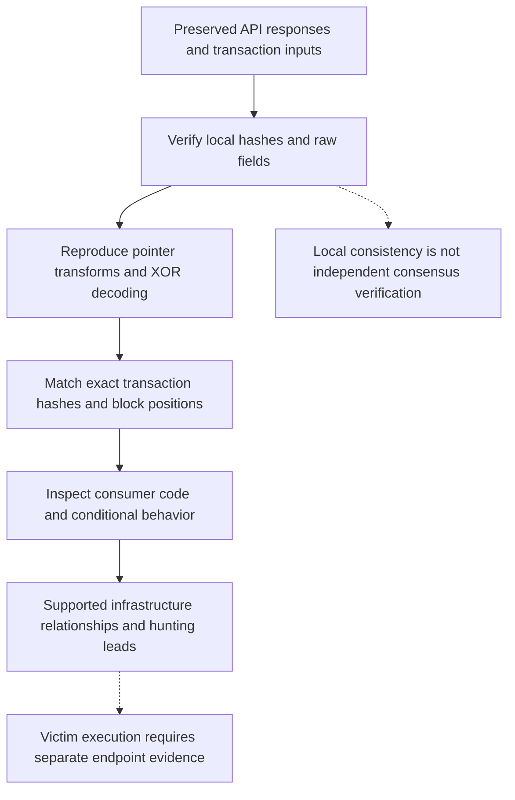

#### Publisher and code relationships

The original parser reads the latest confirmed outgoing TRON transaction for `TMpR4viF4xPeMAcgYDoF57ECAaDPpj1oXs`. Its captured memo resolves to BSC transaction `0x4e1c5867249c1768eff6e2467d1983ae92cb60d28345b8424b080df32f9cd770`, published by `0x1f9eeaf3ebf612983e729b57c270cfdd90ef44dc`. Reversing the input and applying the ASCII XOR key `02020327030306210219` recovers the loader. This is transaction-input storage: the loader is designed to recover the JavaScript for interpretation on the endpoint. An Ethereum-style RPC method name does not identify the chain; the selected provider and chain ID do.

The earlier BSC publisher, `0xde154aa848f3ed05bcce78971e98e7775be453ae`, links into this seed in two useful ways. It publishes earlier reverse/XOR loaders, and on August 25 it transfers **0.0009471875 BNB** directly to the later publisher. Its July 6 nonce-zero publication contains a damaged outer program but recoverable inner resolver code. The resolved static view is byte-identical to a publication from historical publisher `0x9bc1355344b54dedf3e44296916ed15653844509`. The two static files share SHA-256 `4f836ce6940b4ff7c6051d01bb6ef618488090d78ec8f87dc722ebf5334b4fcb`; retained transform records also identify the same intermediate inner-code hash.

These relationships justify following the historical publisher and its source-referenced feeds. They do not make every transfer involving those accounts malicious. They also do not establish that the damaged July outer program ran successfully.

| Relationship | Evidential strength | Permitted analytical conclusion |
| --- | --- | --- |
| Original parser → TRON memo → exact BSC input | High: source-defined transform and matching retained bytes | Direct infrastructure used by the captured Git-hook loader design. |
| Earlier → later BSC publisher | High for the transfer; reinforced by loader similarity | Infrastructure continuity worth monitoring; ownership remains an inference. |
| Earlier publisher → historical publisher's code | High for identical resolved static bytes | Code lineage connecting the investigation to a broader resolver corpus. |
| TRON/Aptos fields → exact BSC resolver | High for field equality, decoding and source consumers | Related pointer feeds and resolver versions. |
| Shared XOR key or command vocabulary | Supporting evidence | Candidate clustering; require stronger joins before promotion. |
| Common gateway, bridge, exchange, token contract or dead-address recipient | Insufficient on its own | Context or a research lead, not campaign ownership. |

The direct funding transaction is `0x827b7990ff2ffff8198127c6ffb1537f6ff7b9b4d96c96a14b6a300185572fc2`. This is a **funds-transferred** relationship; the publication and selection relationships are supported by separate evidence. The baseline package also contains bridge-route analysis, but its amounts are not treated here as theft proceeds or proof of infrastructure ownership.

**Figure 8. Evidence supporting cluster expansion.**

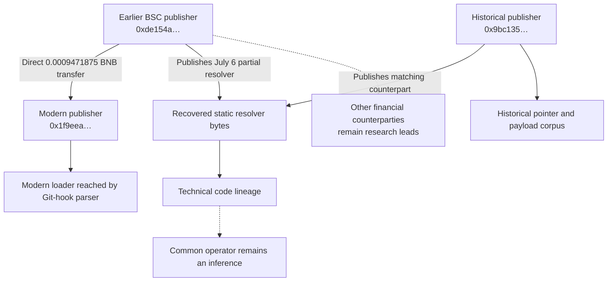

#### Collection scope and validation

The working set combines the original incident evidence in Part I, `Multichain_Research_Update`, and the later `Blockchain_Code_Evidence` supplement. The second directory named `Multichain_Research_Update 2` duplicates the first package apart from `.DS_Store`; it contributes no additional independent observations.

The <span title="Offline evidence reference: hunting-analysis/audit_blockchain_evidence.py">offline audit</span> checks retained input hashes, reproducible XOR transforms, raw TRON memo fields, Aptos argument joins, signal fields, BSC block/index positions, package-manifest hashes and selected artifact relationships. It reads JSON and inert payload files without importing supplied research helpers or executing recovered programs. <span title="Offline evidence reference: hunting-analysis/audit-results.json">Audit results</span> record **4,239 passing checks**, including **270 XOR replays**. These overlapping checks establish local consistency, not 4,239 independent observations or consensus-level blockchain authentication.

| Evidence population | What the retained collection supports | Coverage limit |
| --- | --- | --- |
| BSC corpus | 353 unique transaction records; 264 cataloged as syntax-valid outer decodes, 67 undecoded, 20 without payload, two partial/malformed | Includes funding, ordinary contract calls and ambiguous inputs; not 353 malicious programs. Syntax classifications are inherited from the supplied parsing results. |
| Historical Ethereum publisher | 24 transaction records | Separate from the signal sender and from Ethereum funding records for the modern publisher. |
| TRON memo inventory | 165 unique memo-bearing records; **164 validated recorded-profile joins to 161 distinct BSC hashes** | One additional memo is unresolved under the inventory's profiles; see below. |
| Ethereum signal sender | 100 unique transactions, nonces 201–300, October 13 20:33:59 through October 17 09:19:35 | Bounded history. Consecutive nonces support continuity inside this window, not complete lifetime coverage. |
| Aptos convergence | Two captured transfers from one account select two retained BSC resolver versions | Other queried accounts and empty/error responses do not establish absence of activity. |
| Application-injection child | Exact extracted literal hash and inspected source of an October 15 RAT child | Runtime injection body and successful host modifications remain unobserved. |

**Unresolved memo and inventory limitation.** The supplied `missing_targets.json` is empty, but its generating logic adds only already-resolved candidates to the target set. An empty result therefore cannot establish that every memo resolved. Transaction `f925db9fc32337057934634a8b1fb12fb7a0bf65ca819cc1c8a4afae7c97edf7` contains the plain, unprefixed text of an existing BSC hash, `7fe820155d004885c481ecc6dd784f87781594f1564a3ef56fdd8d92cb8ab275`. Adding `0x` gives an exact corpus match; the inventory's attempted half-swap does not. This remains an **analyst-normalized candidate** because its relevant consumer has not been established. It adds no new distinct target because that BSC transaction is already reached elsewhere.

Two linked TRON captures, for `TMfKQEd7TJJa5xNZJZ2Lep838vrzrs7mAP` and `TXEpFtxxedNs3UtNYgmFRwdf6N3Z9f96ZJ`, have no successful HTTP response in the retained wrapper. They are collection gaps, not evidence that the accounts are inactive. This is why a hunting pipeline needs separate states for “no records,” “request failed,” “unresolved encoding” and “validated pointer.”

#### Infrastructure relationship diagrams

These diagrams distinguish public publication and selection evidence from endpoint execution evidence.

**Figure 9. The publication, selection and endpoint layers.**

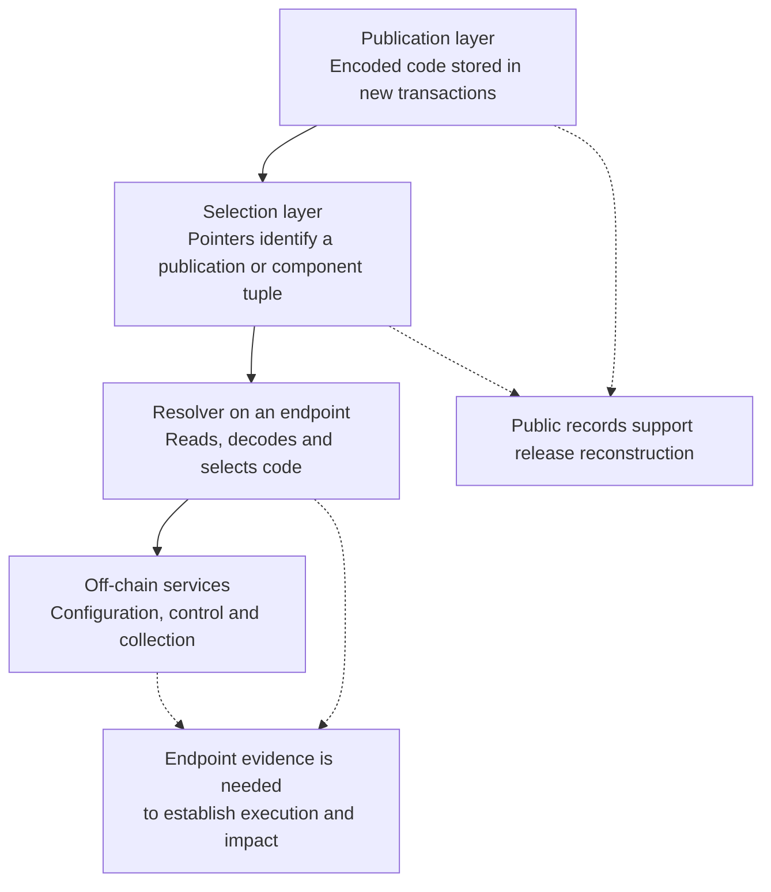

**Figure 10. Evidence relationships connecting the original and expanded branches.**

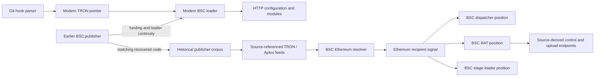

#### Section IOCs and hunting markers

| Type | Indicator | Role and evidence status |
| --- | --- | --- |
| Modern BSC publisher | `0x1f9eeaf3ebf612983e729b57c270cfdd90ef44dc` | Original loader publisher. |
| Earlier BSC publisher | `0xde154aa848f3ed05bcce78971e98e7775be453ae` | Loader similarity and direct funding relationship; common ownership not established. |
| Historical BSC publisher | `0x9bc1355344b54dedf3e44296916ed15653844509` | Matching resolved code links the broader corpus; evaluate individual publications. |

### Exact transformations and transaction proofs

This section preserves the byte-level transformations, full identifiers, source locations and hashes behind the article. The runnable reproduction is in <span title="Section not included in the updated source report: #offline-reproduction">Offline reproduction</span>.

#### The original branch: a TRON memo selects a BSC loader

The capture `raw/tron_TMpR4viF4xPeMAcgYDoF57ECAaDPpj1oXs.json` contains TRON transaction `f1d8f489ea6ac58d954d3a9bbbf3c8032ae56547640ad371b2fe0eec949ae661`, whose `raw_data.data` field carries the pointer. The parser issues the following query:

```text
GET https://api.trongrid.io/v1/accounts/TMpR4viF4xPeMAcgYDoF57ECAaDPpj1oXs/transactions?only_confirmed=true&only_from=true&limit=1
```

In this branch, the parser swaps the two halves of the **hex string**, decodes the result as ASCII, and prepends `0x`. The transformation can be expressed as:

```python
memo_hex = transaction["raw_data"]["data"]
mid = len(memo_hex) // 2
bsc_hash = "0x" + bytes.fromhex(memo_hex[mid:] + memo_hex[:mid]).decode("ascii")
```

The resulting BSC reference is:

```text
0x4e1c5867249c1768eff6e2467d1983ae92cb60d28345b8424b080df32f9cd770
```

The client submits a read-only JSON-RPC request to a BSC provider:

```json
{"jsonrpc":"2.0","id":1,"method":"eth_getTransactionByHash","params":["0x4e1c5867249c1768eff6e2467d1983ae92cb60d28345b8424b080df32f9cd770"]}
```

The parser recovers the payload from `result.input` by removing `0x`, hex-decoding, reversing, and XORing against the repeating **ASCII** bytes of `02020327030306210219`. The key is not a hex-encoded byte array. For this captured ASCII input:

```python
raw = bytes.fromhex(result["input"][2:])
key = b"02020327030306210219"
plain = bytes(c ^ key[i % len(key)] for i, c in enumerate(raw[::-1]))
```

The 7,863-byte output hashes to `c43ee3e3535257a15617b89a5cd5f8ba7454076f94a1f8a46a1f1a4dc834b3e0`. This is the outer decoded source **before** the original parser's first-occurrence replacement of `9999` with `30625599`. The source reverses text. The offline replay verifies that these captures are ASCII before using byte reversal; arbitrary Unicode ciphertext would require the source language’s string semantics.

A new outgoing memo can change `bsc_hash`, so the same installed parser can retrieve another publication without changing its embedded TRON account. The captured nine modern publications demonstrate historical updates; they do not prove every posted version was successfully executed.

**Figure 11. Modern branch: from memo bytes to decoded loader.**

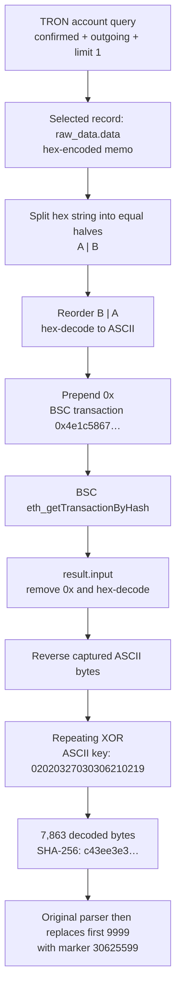

#### The expanded branch: TRON and Aptos reference the same resolver

This branch uses different pointer fields and encoding. For TRON transaction `aac5df301ee34986a8a9d3a9c3fe186dd9388ab0db04c17ec37ff948ff2eab62`, the UTF-8 memo text is:

```text
8092a6627a4fceb99923f091157e59d35f1d682b294bf1800fad177ccf701469x0
```

The pointer is recovered by reversing the decoded text:

```python
target = bytes.fromhex(transaction["raw_data"]["data"]).decode("ascii")[::-1]
```

For Aptos transaction `0x2e576cd459dac99ae4d62c2d221bd75dbf2fe7c6ed1a047771f41b7353b1a502`, the reference is stored directly in `payload.arguments[0]`. Both yield:

```text
0x964107fcc771daf0081fb492b286d1f53d95e751190f32999becf4a7266a2908
```

The retained resolver family contains a TRON-first read with an Aptos read in its catch path. An example is the <span title="Offline evidence reference: multichain-proactive-hunting/Multichain_Research_Update/payloads/0x50034039ffe56277e464484d239b8c22bb7c9ef59e9471e7914ae99f223de573.static.txt">historical resolver source</span>, which uses an earlier account pair. Different versions also pass account values through globals. Consequently, field convergence establishes two references to this BSC object; it does not by itself prove that every historical bootstrap can decode the current object or that both feeds were consulted in one execution. A `limit=1` API request also must not be assumed to mean “newest” independently of that API's ordering.

The selected BSC resolver uses a framed input:

```text
?.? + XOR-encoded JavaScript + ?.?  
```

Component 1 of `input.split(b"?.?")` is decoded by XOR with the retained resolver's recovered key `2[gWfGj;<:-93Z^C`. Its 5,704-byte input produces 5,698 decoded bytes with SHA-256 `680462cf3093c8ad799b490489fa721417809345e476eb4647eebaa1eae2bc16`. This decoding key is an analyst-reproduced property of this publication; compatibility with a particular upstream consumer requires that consumer's own key and control path to agree.

The decoded output still contains source obfuscation. The accompanying `.readable.txt` is a separately recovered inspection view. The reproduction in <span title="Section not included in the updated source report: #offline-reproduction">Offline reproduction</span> verifies the outer bytes against `.decoded.txt`; it does not claim to regenerate every readable view or solve all control flow.

**Figure 12. Two field-level pointers converge on one resolver publication.**

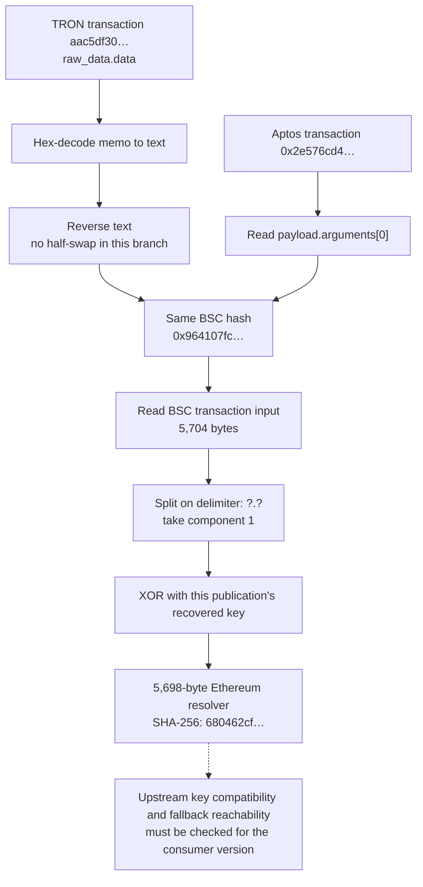

#### Ethereum signal discovery through sparse block sampling

The BSC resolver now searches Ethereum. It requests `eth_blockNumber`, aligns the head to a 256-block boundary, adds five, and examines three adjacent blocks at each sparse offset:

```python
anchor = (head // 256) * 256 + 5
if anchor > head:
    anchor -= 256
for offset in [0] + [2**i for i in range(13)]:
    for j in range(3):
        block_number = anchor - offset * 256 + j
        # eth_getBlockByNumber(hex(block_number), True)
        # first transaction whose from contains the source marker wins
```

For the saved head `26211484`, the anchor is `26211333`. The captured replay reads blocks `26211333`, `26211334`, then `26211335`, and finds the signal in the third block. The matching condition is `transaction.from.includes("596dcc9fda875309ff85eba09cf5a97d")`. It returns that transaction's `to` field and stores it in `global.ix`.

The JSON-RPC request for the matching Ethereum block is:

```json
{"jsonrpc":"2.0","id":1,"method":"eth_getBlockByNumber","params":["0x18ff407",true]}
```

The scan requests full transaction objects, not event logs. It stops at the first match in its traversal order; it is not a general “latest transaction” query. There are at most 42 candidate block lookups, excluding provider retries and the initial head request. The large maximum lookback is sparse, so an unsampled block remains invisible to this algorithm.


#### The captured signal and its selected publications

A TRON memo from `TCqf6ZkaQD84vYsC2cuu1jRwB6JveTaRrF` and an Aptos transfer from `0x9d202c824402ca89e9aaccd2390b6f8b332ae743caa1469c695feb2781d56519` converge on BSC resolver `0x964107fcc771daf0081fb492b286d1f53d95e751190f32999becf4a7266a2908`. The TRON transaction is `aac5df301ee34986a8a9d3a9c3fe186dd9388ab0db04c17ec37ff948ff2eab62`; the Aptos transaction is `0x2e576cd459dac99ae4d62c2d221bd75dbf2fe7c6ed1a047771f41b7353b1a502`.

The resolver searches Ethereum senders for the substring `596dcc9fda875309ff85eba09cf5a97d`. The captured matching sender is the full address `0x596dcc9fda875309ff85eba09cf5a97d8c7691bb`. The full sender is the primary watchlist entry; the substring is a source-code search artifact.

Ethereum signal `0x48d71961dc7e0849d4c6bf7e4a95e65ad62b6ba458ff786c0997dbcd64746369`, recorded October 17 at 09:19:35, has recipient:

```text
0x 0784a79e52 07a13ec538 079509c84b 0783e08100
   dispatcher RAT        loader     unassigned
```

Spaces above are explanatory. Each five-byte group can be read as a four-byte block number and one-byte transaction index. Consumer code establishes that meaning for the first three groups only.

| Group | BSC block / index | Exact selected transaction |
| --- | --- | --- |
| Dispatcher | 126134174 / 82 | `0x9f8d2c3b9415cacea3569ff5b9580e668b5a5899107e328aa324140988adbeb8` |
| RAT | 128007877 / 56 | `0x146b28b62a385ca37775d6217c6299838a5ba90b448e203e0ab7c2c3e48134b9` |
| Stage loader | 127207880 / 75 | `0x304e337f173d6d4efa3bc6f483e4afe457f01d7f0e51cab39ad05f0f88050ce4` |
| Fourth group | 126083201 / 0 under the same arithmetic | No established consumer or matched target in this corpus. Retain as an unresolved field. |

All three consumed targets have matching captured BSC positions. Their consumer-provided XOR keys are respectively `8l%Sljl>J>U61O,n`, `}aY<_o-)LNt($[%_` and `N#Y#;c<$4ni%j?Ud`. Position, decoding and source behavior together support the join. These are public decoding constants, not wallet private keys.

For independent verification, an analyst lookup can use `eth_getTransactionByBlockNumberAndIndex` on a BSC provider and verify the returned hash and input. The recovered resolver instead fetches whole blocks with `eth_getBlockByNumber(..., true)` and indexes the transactions array. The analyst shortcut should not be mistaken for the malware's actual network signature. The official [Ethereum execution API specification](https://ethereum.github.io/execution-apis/api/methods/eth_getTransactionByBlockNumberAndIndex/) documents the block/index lookup semantics.

#### Recipient fields select the dispatcher, RAT and stage loader

The recipient is a 20-byte value, comprising four five-byte groups. Each consumed group uses a big-endian four-byte block number followed by a one-byte transaction index. JavaScript offsets below include the leading `0x`; end offsets are exclusive.

| Component | Recipient byte offsets | JavaScript block substring | Index substring | Key |
| --- | --- | --- | --- | --- |
| Dispatcher | 0–4 | `substring(2,10)` | `substring(10,12)` | `8l%Sljl>J>U61O,n` |
| RAT | 5–9 | `substring(12,20)` | `substring(20,22)` | `}aY<_o-)LNt($[%_` |
| Loader | 10–14 | `substring(22,30)` | `substring(30,32)` | `N#Y#;c<$4ni%j?Ud` |
| Unassigned | 15–19 | No established consumer | No established consumer | Unknown |

The outer resolver consumes the dispatcher group. The dispatcher's recovered nested resolver strings 38 and 51 consume the RAT and loader groups using the same `global.ix`. Those resolvers fetch BSC blocks, select `transactions[index].input`, take framed component 1, and XOR with their respective keys. The RAT resolver also checks a `-skipwarn` argument and a `_t_h` process-global guard; a valid pointer therefore does not guarantee repeated execution in the same process. <span title="Offline evidence reference: multichain-proactive-hunting/Multichain_Research_Update/payloads/0x9f8d2c3b9415cacea3569ff5b9580e668b5a5899107e328aa324140988adbeb8.nested_38.readable.txt">RAT resolver source</span>, <span title="Offline evidence reference: multichain-proactive-hunting/Multichain_Research_Update/payloads/0x9f8d2c3b9415cacea3569ff5b9580e668b5a5899107e328aa324140988adbeb8.nested_51.readable.txt">loader resolver source</span>.

One implementation detail affects faithful replay: the source increments the index by 256 only if an exception occurs while reading/decoding a transaction. A missing delimiter can return `undefined` without throwing at that point. The implementation therefore does not establish an unconditional search across all indexes congruent modulo 256. The saved three targets match their first index directly; no such fallback is needed to reproduce them.


#### Case study: the October 15–16 RAT replacement

The October 15 and October 16 selections differ in exactly one five-byte group:

```text
October 15: 0x 0784a79e52 079ef78a29 079509c84b 0783e08100
October 16: 0x 0784a79e52 07a13ec538 079509c84b 0783e08100
                         ^^^^^^^^^^
                         RAT locator only
```

`079ef78a29` resolves to block `127858570`, index `41`; `07a13ec538` resolves to block `128007877`, index `56`. The first points to `0xd5de281a8a3e71e49ee6d016459d6b5d65b764122e43a02a838c61268be5951e`, the second to `0x146b28b62a385ca37775d6217c6299838a5ba90b448e203e0ab7c2c3e48134b9`.

The old RAT decodes to 84,385 bytes, SHA-256 `1e5b7eb0180564f1209ec2178c1316759c084e1cc442f0a1088ef774b862523f`. The new RAT decodes to 78,966 bytes, SHA-256 `309cc258f2ed6c5aa28fceb49a887b4a84d0ec1d9dc28f4f6a68dbeb2f0e33bc`. The different decoded hashes establish different published code, while the unchanged other groups establish that this signal transition does not select a different dispatcher or stage loader.

The new RAT was published October 16 at **16:09:25**. The first captured signal selecting it, `0x7ff94093e1912bc07e18fa9ee2481bfed3c0257d245904437e466197bb4336f3`, appears at **16:12:47**, but lies outside residues 5–7. The first captured signal for this version in a sampled residue is `0x61e5543057a20a378785c775246bb461b5b72017853cf33e4f7ddf09434b37db`, block `26206470`, at **17:03:35**. That is **54m10s after publication**. A sampled residue is necessary, but selection still depends on invocation head and traversal order; it is not proof of victim execution.

This example separates three measurable events: **code publication → announcement → a signal eligible for this resolver's block sampling**. The 3m22s interval measures announcement. The later sampling-eligible signal establishes a different point in the release timeline.


#### Timing measurements and search coverage

Recomputing the captured signal history shows six recipient values and five transitions. Only the RAT group changes. The dispatcher, loader and fourth groups each retain one value throughout the window. That supports independent component replacement within this bounded series; it does not establish a universal release model for every branch.

| RAT publication UTC | First captured selecting signal UTC | Publication-to-signal interval | Signals in window |
| --- | --- | --- | ---: |
| October 13 15:50:01 | October 13 20:33:59 | 4h43m58s; left-censored, exclude from activation estimate | 20 |
| October 14 13:25:32 | October 14 13:42:35 | 17m03s | 5 |
| October 14 17:56:15 | October 14 18:00:11 | 3m56s | 26 |
| October 15 15:26:25 | October 15 16:14:59 | 48m34s | 7 |
| October 15 21:28:43 | October 15 22:14:23 | 45m40s | 21 |
| October 16 16:09:25 | October 16 16:12:47 | 3m22s | 21 |

For the five transitions whose preceding selection is visible, the median interval is **17m03s**. These are publication-to-first-captured-selection measurements, not payload build times, first-ever use across all channels or attacker working hours. Full hashes and recipient values are available in <span title="Offline evidence reference: hunting-analysis/signal-rotations.csv">signal-rotations.csv</span>.

The 99 inter-signal intervals range from **50m00s to 52m48s**, with a median of **51m24s**. Block spacing ranges from 249 to 263, centered on a median of 256. Together with the resolver's 256-block alignment, this is consistent with recurring publication near that boundary. The data does not establish the publisher's scheduling implementation.

The resolver checks three adjacent blocks at each of 14 sparse offsets. Every sampled block has residue 5, 6 or 7 modulo 256. **83 captured signals fall in those residues; 17 fall in residues 8–12.** Those 17 cannot be selected by this resolver's inspected block-search algorithm. They remain relevant infrastructure activity, and earlier eligible signals may still supply a selection. The count is therefore not a 17% victim failure rate.

**Hunting implication:** maintain two views. A full sender-history collector identifies every retained signal and version change. A faithful resolver replay explains which selection a particular consumer could retrieve at a particular head. Combining them prevents “latest published,” “latest signaled” and “actually selectable” from being treated as identical states.

#### Section IOCs and hunting markers

| Type | Indicator | Role and evidence status |
| --- | --- | --- |
| BSC resolver transaction | `0x964107fcc771daf0081fb492b286d1f53d95e751190f32999becf4a7266a2908` | Exact encoded publication used in the expanded pointer proof. |
| Ethereum sender | `0x596dcc9fda875309ff85eba09cf5a97d8c7691bb` | Verified sender in the bounded 100-signal collection; monitor outgoing transactions. |
| Ethereum recipient | `0x0784a79e5207a13ec538079509c84b0783e08100` | Captured component-selection value; treat as encoded locations, not proof of recipient ownership. |
| Selected RAT transaction | `0x146b28b62a385ca37775d6217c6299838a5ba90b448e203e0ab7c2c3e48134b9` | Exact block/index and decoder match documented in this section. |

### Indicator of compromise

The following lists consolidate the indicators used in this report. Captured delivery infrastructure, source-defined C2, historical references, blockchain publications, and host artifacts retain their stated roles. A blockchain address or transaction identifies infrastructure or published data; it does not establish victim compromise or common ownership. Network observations are bounded by the capture dates described above.

#### Original Git-hook campaign: delivery and C2

- `chgver[.]s[.]gy/707w` — Confirmed entry redirect.
- `167.148.88[.]203:80` — Confirmed batch/parser/package delivery server.
- `104.234.94[.]198:1144` — Confirmed configuration response.
- `107.182.130[.]226:1144` — Coded configuration fallback; primary was sufficient during capture.
- `107.182.130[.]226:1244` — Confirmed encrypted main/client/module delivery.
- `107.182.130[.]226:2225` — Confirmed Windows runtime delivery; coded telemetry endpoint.
- `104.153.82[.]91:2800` — Node Socket.IO C2 from source.
- `107.182.130[.]29:2800` — Decoded Node backup configuration.
- `107.182.130[.]29:2250` — Python Socket.IO C2 from source.
- `104.153.82[.]90:2245` — Python TCP C2 from source.
- `107.182.130[.]29:2245` — Backup configuration field; not a verified live connection.
- `107.182.130[.]213:1274` — Credential/system-information and file-collection destination from source.
- `144.172.118[.]214:80` — Coded delayed AES payload source; retrieval failed.
- `www.jsonkeeper[.]com/b/KRCKK` — Confirmed hosted backup configuration.
- `147.124.202[.]194` — Comment-only previous host string in payl; inactive in the captured source.

#### Proactive hunt: additional network infrastructure

- `154[.]91[.]0[.]20:443` using **HTTP** — Control base in the October 16 selected RAT. Inspect protocol-aware network telemetry and process identity. Port 443 alone must not force TLS classification.
- `166[.]0[.]106[.]182` using HTTP — Upload base in the selected RAT; also referenced by the selected stage loader. Escalate when paired with the selected RAT artifacts, control destination or unexpected interpreter activity.
- `89[.]19[.]222[.]25`, `181[.]214[.]149[.]148` — Historical HTTP stager variants. Retrospective hunt for `/0/body` with an `X` header, or `/init`; do not assert current service activity.
- `154[.]91[.]0[.]196:443/download/2` using HTTP — Historical, host-gated Python download branch. Search for hidden/detached `py -c` activity and the exact request context; this branch is not universal.

#### Blockchain accounts and publishers

- TRON `TMpR4viF4xPeMAcgYDoF57ECAaDPpj1oXs` — Direct modern pointer feed, five memo records.
- TRON `TUS6fj1ZcsZVdGtPspVNH9jY4yqywHaHDm` — Earlier feed; six validated memo joins plus the unprefixed candidate.
- BSC `0x1f9eeaf3ebf612983e729b57c270cfdd90ef44dc` — Modern publisher, four reverse/XOR code publications among 18 outgoing records.
- BSC `0xde154aa848f3ed05bcce78971e98e7775be453ae` — Earlier publisher, five modern loaders plus the partially damaged historical resolver.
- BSC `0x9bc1355344b54dedf3e44296916ed15653844509` — Historical publisher, 308 outgoing records in the retained history.
- Ethereum `0x596dcc9fda875309ff85eba09cf5a97d8c7691bb` — Verified signal sender.
- TRON `TCqf6ZkaQD84vYsC2cuu1jRwB6JveTaRrF` — 28 memo records, including the October resolver pointer.
- Aptos `0x9d202c824402ca89e9aaccd2390b6f8b332ae743caa1469c695feb2781d56519` — Two captured transfer-argument pointers.
- TRON `TA48dct6rFW8BXsiLAtjFaVFoSuryMjD3v` — historical pointer feed; 62 retained memo records.
- TRON `TLmj13VL4p6NQ7jpxz8d9uYY6FUKCYatSe` — historical pointer feed; 58 retained memo records.
- TRON `TLmW5dMPTmtdgBKgKexc4uXZuvvEUU2DeF` — historical pointer feed; 5 retained memo records.

#### Selected transaction and component identifiers

- BSC transaction: `0x4e1c5867249c1768eff6e2467d1983ae92cb60d28345b8424b080df32f9cd770` — Captured encoded loader publication; identifies code, not a victim.
- Ethereum recipient: `0x0784a79e5207a13ec538079509c84b0783e08100` — Captured component-selection value; treat as encoded locations, not proof of recipient ownership.
- Selected RAT transaction: `0x146b28b62a385ca37775d6217c6299838a5ba90b448e203e0ab7c2c3e48134b9` — BSC block 128007877, index 56; publication selected by recipient bytes.
- BSC resolver transaction: `0x964107fcc771daf0081fb492b286d1f53d95e751190f32999becf4a7266a2908` — Captured source interprets Ethereum recipient bytes as BSC locations.

#### Host paths and behavioral markers

- **Windows delivery/runtime:** `%USERPROFILE%/token.cmd`, `%USERPROFILE%/.task/parser.js`, `%USERPROFILE%/.task/package.json`, `%USERPROFILE%/.bash/python.exe`; temporary `gradle-9-bin_<number>` downloads.
- **Client identifiers and locks:** `~/.vscode/.argv8`, `~/.vscode/.ncli.pid`, `~/.vscode/.argv3`, `~/.vscode/.argp3`, and `~/.vscode/.poc3`. These support client identity or instance management; they are not all persistence mechanisms.
- **Linux persistence/runtime:** `~/.config/autostart/PyToolUpdater.desktop`, `~/.viminf`, and `~/.py/python/bin/cupsd`.
- **macOS persistence:** A `PyToolUpdater` bootstrap block in `~/.zprofile`; `/tmp/PyToolUpdater.pid` and `/tmp/PyToolUpdater.log`.
- **macOS collection/browser launch:** `~/Library/LaunchAgents/com.local.cdp.chrome.plist`, `~/Library/Logs/cdp-chrome.out.log`, `~/Library/Logs/cdp-chrome.err.log`, `/tmp/chrome_stealth`, `~/.sd/chrome`, and `~/.sd/brave`. The collector contains LaunchAgent cleanup logic, so include historical creation/deletion events.
- **Browser database staging:** `%USERPROFILE%/AppData/Local/Temp/LoginData.db` and `webdata.db`, or their `/tmp` equivalents. These are staging paths referenced in code; creation and successful collection must be established from telemetry.
- **Repository hooks:** `.git/hooks/post-checkout`, `.git/hooks/pre-commit`, and `.git/hooks/pre-push`; inspect contents and any `core.hooksPath` override.

Host paths and process markers require contextual matching; they are not individually conclusive. Public RPC providers, nodejs.org, shared service domains, package names, and the analyst identifier `analysis_vm` are not standalone malicious indicators.

#### Artifact SHA-256 hashes

- **Original ZIP:** `8a681cb0ef19b1db0c42d4fc666c8a07eec1682ea3b2379066a50ce21b877491`
- **Each malicious hook:** `9dd7e653c845bc8ca4f0ad781dbf1d82b2dbe5d8a9045ca8132d74c3b8911022`
- **Captured Windows dropper:** `0b453753847ddafb7761bb8a6a55d12a9a98ca8a157070081541d8862094339a`
- **Captured token.cmd:** `89e44eac4d79a68017b164788da3e005cd2fc0bec094d4447ee030f5504e90ca`
- **Captured parser.js:** `c6b0092a4441d696733b03f677794b22c6079cef7efdbaa8c7c50ae7f0de8413`
- **Blockchain decoded JS, before runtime-marker replacement:** `c43ee3e3535257a15617b89a5cd5f8ba7454076f94a1f8a46a1f1a4dc834b3e0`
- **Decrypted main loader:** `c443a6c9406abb13406be5618cc7831eaabf2f319beb66fe7de2a296a65f48f5`
- **Decrypted client loader:** `c9ffa2bf788a4ad683d521333658d719d932b7ffa9f00667adc2daff6388d360`
- **Decrypted ncli JS:** `2a1854d1517b15b4a05114f52f7028ea3bbd8789755d16be3b160162f9343024`
- **Fully unpacked payl Python:** `88b31249e2d56489debd67dc7d3d597dc53744749503c9dfc1104ec4e57fd22e`
- **Fully unpacked payload Python:** `e8b9966633ec2ec9911408e6afae722ca4168e9d5ff77dce3646ce8805b27784`
- **Fully unpacked brow Python:** `7fd19af9724724dc9adc1612885123fc33de7609efac19f6874b2e1a3df22e49`
- **Decrypted ldb JS:** `69a2c90d8813c66e3cb919c221f6616e9ce88e6e0c6c3ea332b011c97f6a6b34`
- **Decrypted mdb JS:** `b6a6efb36c55a841e9e401033ddac0a91853fe3fd78a105020986bc5b540ae56`
- **Windows Python runtime archive:** `647113e165122d3abc0c6935971524783354a357ed93e9b820226c0ab4da0eeb`
